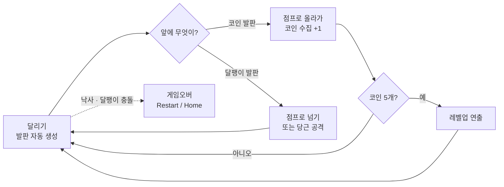

# 01. 게임 컨셉 제안서 — BunnyRunning

> 문서 세트: [목차](Proposal.md) · **01 컨셉** · [02 시스템](02_System.md) · [03 전투·개체](03_Combat_Entity.md) · [04 레벨 디자인](04_LevelDesign.md) · [05 밸런스](05_Balance.md) · [시뮬레이션](Simulation.html)

---

## 한 줄 정의 (Elevator Pitch)
> **버튼 두 개(점프 · 공격)로 봄 들판을 달리며, 코인을 모으고 달팽이를 당근으로 물리치는 한 손 러너.**

| 항목 | 내용 |
|---|---|
| 장르 | 2D 횡스크롤 러너 (자동 달리기) |
| 플랫폼 | 모바일 가로 화면 (앱인토스 미니앱 · itch.io · Game Jolt), PC |
| 엔진 | Unity 6 (6000.5.3f1) · C# · 새 Input System · Apps in Toss SDK |
| 플레이 시간 | 한 판 30초 ~ 3분 |
| 타깃 유저 | 출퇴근길 · 대기 시간에 짧게 즐기는 모바일 캐주얼 유저 |

## 핵심 재미 (Core Fun)
| 키워드 | 무엇이 재미있나 | 코드 근거 |
|---|---|---|
| **점프 컨트롤** | 길게 누르면 높이, 짧게 누르면 낮게 + 공중 연속 점프 | `Player` (떼면 속도 × 0.5) |
| **피할까, 쏠까** | 달팽이를 점프로 넘을지 당근으로 치울지 판단 | `CarrotProjectile`, `SnailPatrol` |
| **수집 · 성장** | 코인을 먹을 때 "+n" 글자가 톡 떠오르고, 5개마다 레벨업 연출 | `Coin`, `LM`, `FloatEffect` |
| **봄 분위기** | 무한 스크롤 배경, 떨어지는 별 파티클, 씬별 BGM | `BackgroundLoop`, `SM` |

## 코어 루프


| 루프 | 주기 | 현재 | 💡 제안 |
|---|---|---|---|
| 순간 루프 | 1 ~ 2초 | 발판 하나 넘기 | – |
| 세션 루프 | 30초 ~ 3분 | 달리기 → 레벨업 → 게임오버 | 레벨마다 속도 · 달팽이 비율 상승 (→ 04) |
| 장기 루프 | 여러 판 | 없음 | 최고 점수 저장 · 코인으로 후드 스킨 구매 |

## 레퍼런스 대비 차별점
| 레퍼런스 (장르) | 가져온 점 | BunnyRunning의 차이 |
|---|---|---|
| 모바일 쿠키형 러너 | 자동 달리기 · 점프 · 젤리(코인) 수집 | **공격 버튼**으로 적을 직접 처리하는 선택지 |
| 엔드리스 러너 (터치 한 번 점프) | 한 손 조작, 즉시 재시작 | 짧게 / 길게 누르기로 **점프 높이 조절** |
| 캐주얼 미니게임 플랫폼 | 짧은 세션 · 광고 수익 | 앱인토스 미니앱으로 바로 배포 |

## 화면 구성 (와이어프레임, 가로)
```
┌──────────────────────────────────────────────────────────┐
│ Score: 12   LV. 3                                         │
│                               🪙🪙🪙                       │
│        🐰                   ▀▀▀▀▀▀▀▀         🐌            │
│      ▀▀▀▀▀▀▀▀                            ▀▀▀▀▀▀▀▀          │
│                                                (공격 버튼) │
│ [ 화면 아무 곳 터치 = 점프 ]                    [ 🥕 ]     │
│ ─────────────── 배너 광고 (하단) ───────────────          │
└──────────────────────────────────────────────────────────┘
```

## 수익 모델
| 광고 | 노출 시점 | 현재 |
|---|---|---|
| 배너 | 화면 하단 상시 | ⚠️ 함수만 있고 호출 없음 |
| 전면 | 3번 죽을 때마다 (로드 완료된 경우만) | ⚠️ 함수만 있고 호출 없음 |
| 💡 보상형 | 게임오버 시 "광고 보고 이어하기" 1회 | 제안 |

> 광고 빈도를 "사망 횟수" 기준으로 둬서 플레이 중에는 흐름을 끊지 않도록 설계했어요. 연결 방법은 [02 시스템](02_System.md) 참고.

## 개발 현황
| 구분 | 상태 |
|---|---|
| 구현 완료 | 점프(높이 조절) · 당근 공격 · 달팽이 · 코인 · 레벨업 · 발판 풀링 · bag 배치 · 무한 배경 · 씬별 BGM · 게임 가이드 · 가로 화면 고정 |
| 출시 준비 | itch.io / Game Jolt 스토어 이미지 · 소개글 (`StoreImages/`) |
| 다음 목표 | 광고 연결 · 최고 점수 저장 · 레벨별 난이도 · 점프 횟수 조정 |
