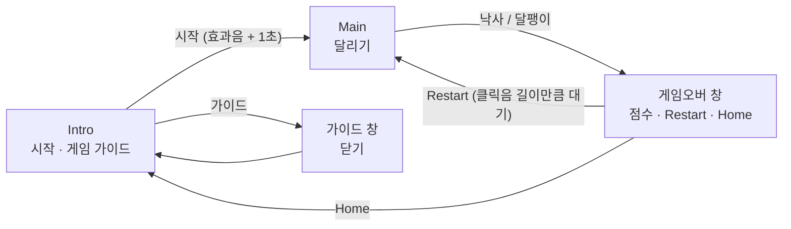
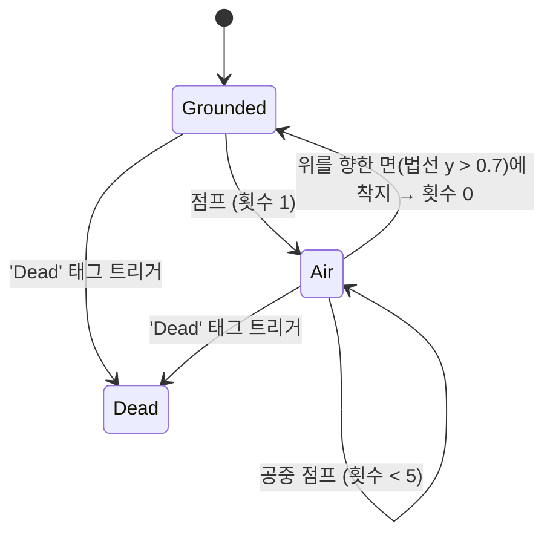

# 02. 시스템 기획서 — 러너 · 발판 · 성장 · 광고

> 문서 세트: [목차](Proposal.md) · [01 컨셉](01_Concept.md) · **02 시스템** · [03 전투·개체](03_Combat_Entity.md) · [04 레벨 디자인](04_LevelDesign.md) · [05 밸런스](05_Balance.md)
> 관련 코드: `Player.cs` · `PlayerInput.cs` · `PlatformSpawner.cs` · `Platform.cs` · `Coin.cs` · `GM.cs` · `LM.cs` · `SM.cs` · `SCM.cs` · `AM.cs`

---

## 1. 화면 흐름도
빌드 씬: `0 Intro` → `1 Main` (`2 protocal`은 테스트 씬)


## 2. 상태 머신
**게임 (`GM`)**
| 상태 | 발판 생성 | 달팽이 | 점수 | BGM |
|---|---|---|---|---|
| Playing | 1.25 ~ 2.25초마다 | 왕복 | 코인마다 +1 | Main 음악 |
| GameOver | 멈춤 | 정지 (애니메이션 끔) | 더 안 쌓임 | 게임오버 음악 |

**러너 (`Player`)**


## 3. 작동 로직
### 3-1. 입력 (`PlayerInput`)
```
PC     : 점프 = Space 누른 순간 / 뗀 순간, 공격 = A 누른 순간 (새 Input System)
모바일  : 점프 = 화면 터치 누른 순간 / 뗀 순간, 공격 = 화면 공격 버튼
```

### 3-2. 점프
```
점프 누름
├─ IF 사망 → 무시
├─ IF 점프 횟수 < 5
│   ├─ 횟수 +1
│   ├─ 속도를 (0, 0)으로 → 위로 힘 700 (질량 1 · 물리 간격 0.02초 → 위 속도 14)
│   └─ 점프 소리(플레이어 전용 스피커, 이전 소리를 끊음) · 점프 이펙트(2초)
└─ ELSE → 무시
점프 뗌
└─ IF 올라가는 중 → 속도 × 0.5 (짧게 누르면 낮은 점프)
착지 (충돌 시작)
└─ IF 첫 접점 법선 y > 0.7 (위에서 밟음) → 바닥, 횟수 0
```

### 3-3. 공격
```
공격 입력
├─ IF 사망 → 무시
├─ 공격 애니메이션
└─ 당근 생성 → 조준 대상(attackTarget)이 있으면 그쪽, 없으면 오른쪽으로 속도 12 → 5초 뒤 제거
당근 충돌 → IF IDamageable → Damage(1) → 이펙트(0.5초) → 당근 제거
```

### 3-4. 발판 생성 (오브젝트 풀 + bag)
```
시작: 달팽이 발판 3개 · 코인 발판 3개를 화면 밖 대기소(0, -25)에 미리 생성
매 프레임
├─ IF 게임오버 → 멈춤
└─ IF 다음 생성 시간 도달
    ├─ 다음 간격 = 1.25 ~ 2.25초 랜덤, 높이 = -3.5 ~ 1.5 랜덤
    ├─ 종류 = bag에서 하나 꺼내기
    │   └─ IF bag 비었음 → [달팽이 × 1, 코인 × 1] 채우고 섞기 (Fisher-Yates)
    ├─ 해당 종류 풀에서 다음 차례 발판 (3개 돌려 쓰기)
    ├─ 끈 상태에서 (x = 20, 높이)로 옮김 → 자식 코인 전부 다시 켬 → 다시 켬
    │   └─ 켜질 때 장애물 활성 (obstacleChance 100%), 달팽이 위치 랜덤 · 상태 초기화
    └─ 발판은 ScrollingObject로 왼쪽 10 m/s 이동
```

### 3-5. 코인 · 점수 · 레벨
```
코인에 Player 태그가 닿음
├─ IF 이미 먹음 → 무시
└─ ELSE → 떠오르는 숫자 · GM 점수 +1(점수 글자 펄스) · LM 코인 +1 · 코인 소리 · 코인 끔
LM 코인 ≥ 5 → 레벨 +1, 코인 0, "LV. n" 빨간 깜빡임, 레벨업 소리(전용 스피커), 레벨업 이펙트
```

### 3-6. 게임오버
```
'Dead' 태그 트리거(떨어짐 영역 · 달팽이)에 닿음 AND 살아 있음
├─ 사망 애니메이션 · 사망 소리 · 속도 0 · isDead
└─ GM.OnPlayerDead()
    ├─ 점수 · 레벨 글자 숨김, "BEST Score: (이번 점수)" 표시
    ├─ isGameover, 게임오버 창 · 이펙트 켬, 공격 버튼 숨김
    └─ 효과음 + BGM을 게임오버 음악으로
```

### 3-7. 광고 (`AM`) — 설계된 흐름
```
시작 → 전면 광고 미리 로드 (로드되면 준비 완료)
게임오버 → OnGameOver(): 사망 횟수 +1
├─ IF 준비 안 됨 OR 사망 횟수가 3의 배수가 아님 → 표시 안 함
└─ ELSE → 전면 광고 표시 → 닫히면 다음 광고 다시 로드
배너 → ShowBanner(): 하단에 표시 / HideBanner()
```

## 4. 예외 처리 (Edge Case)
> ✅ 처리됨 · ⚠️ 문제 · 💡 제안

| # | 상황 | 현재 동작 | 상태 | 처리 방안 |
|---|---|---|---|---|
| 1 | **광고 연결** | `AM`은 Intro 씬에만 있고 씬이 바뀌면 사라짐. `OnGameOver` · `ShowBanner`를 부르는 곳 없음 → 광고가 나오지 않음 | ⚠️ | 💡 `AM`을 `DontDestroyOnLoad`로 유지, `GM.OnPlayerDead()`에서 `AM.ins?.OnGameOver()`, Main 시작 시 `ShowBanner()` |
| 2 | 전면 광고 로드 실패 | 경고 로그만, 게임은 진행 | ✅ | 💡 다음 게임오버 때 다시 로드 시도 |
| 3 | **최고 점수** | "BEST Score" 글자에 이번 판 점수를 표시, 저장 안 함 | ⚠️ | 💡 `PlayerPrefs("BestScore")` 비교 · 저장, "SCORE / BEST" 두 줄 |
| 4 | 같은 코인 두 번 충돌 | `stepped`로 1번만 | ✅ | – |
| 5 | 재사용된 발판의 코인 | 생성 때 자식 코인 전부 다시 켬 | ✅ | – |
| 6 | 풀 크기 3이 부족할 가능성 | 같은 종류 4번째 사용은 최소 7번째 생성(≥ 7.5초 뒤) → 화면 통과(약 3초)보다 길어 안전 | ✅ | 계산은 [05](05_Balance.md) |
| 7 | **공격 연타** | 쿨다운 없음, 당근이 무한히 나감 | ⚠️ | 💡 쿨다운 0.4초 + 버튼 게이지 |
| 8 | 옆면에 부딪힘 | 법선 y ≤ 0.7이면 착지로 안 봄 (벽 타기 방지) | ✅ | – |
| 9 | 발판에서 떨어질 때 | 충돌이 끝나면 공중으로 보지만 점프 횟수는 그대로 → 떨어지면서도 5번 점프 가능 | 💡 | 의도라면 유지, 2단으로 줄이면 "발판 끝에서 점프" 타이밍이 생김 |
| 10 | 씬 이동 버튼 연타 | 막는 장치 없음 → 코루틴 여러 개 | ⚠️ | 💡 `isChanging` 잠금 |
| 11 | 떠오르는 숫자 카운터 | `static`이라 판이 바뀌어도 계속 증가 | ⚠️ | 💡 새 판 시작 때 0으로 |
| 12 | 사운드 매니저 없음 | `SM.ins`가 자동으로 만들어 줌 | ✅ | – |
| 13 | 화면 회전 | 가로 고정 (`LandscapeMode`) | ✅ | – |
