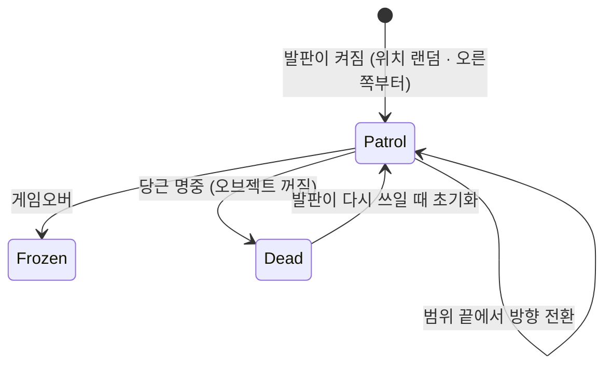

# 03. 전투 · 캐릭터 · 몬스터 상세 기획서

> 문서 세트: [목차](Proposal.md) · [01 컨셉](01_Concept.md) · [02 시스템](02_System.md) · **03 전투·개체** · [04 레벨 디자인](04_LevelDesign.md) · [05 밸런스](05_Balance.md)
> 표기: **현재** = 코드 · 프리팹 · 설정 값 · **💡 제안** = 앞으로 바꿀 값

---

## 1. 조작 방식
| 플랫폼 | 점프 | 공격 | 비고 |
|---|---|---|---|
| 모바일 | 화면 아무 곳 터치 (누르는 시간 = 높이) | 화면 공격 버튼 | 가로 고정 |
| PC | Space (누르는 시간 = 높이) | A | 새 Input System |

## 2. 러너 (토끼) 스펙
| 항목 | 현재 | 계산 · 비고 |
|---|---|---|
| 달리기 | 제자리, **세상이 왼쪽으로 10 m/s** 이동 | `ScrollingObject.speed` |
| 점프 힘 | 700 → 위 속도 **14** | 질량 1, 물리 간격 0.02초 |
| 중력 | **20** (프로젝트 2D 중력) × 1 | `Physics2DSettings` |
| 1회 점프 | 체공 **1.4초**, 높이 **4.9**, 수평 이동 **14** | 체공 = 2 × 14 ÷ 20 |
| 짧은 점프 | 떼는 순간 속도 × 0.5 | |
| 점프 횟수 | **최대 5회** (`jumpCnt < 5`) | ⚠️ README는 2단 → 💡 2단으로 조정 제안 |
| 착지 판정 | 첫 접점 법선 y > 0.7 | |
| 사망 | 'Dead' 태그 트리거 (떨어짐 영역 · 달팽이) | 애니메이션 · 소리 · 정지 |

## 3. 공격 — 당근 (`CarrotProjectile`)
| 항목 | 현재 | 💡 제안 |
|---|---|---|
| 속도 | 12 | – |
| 방향 | 조준 대상(`attackTarget`) 방향, 없으면 오른쪽 | – |
| 데미지 | 1 | – |
| 수명 | 5초 | 1.5초 (화면 밖으로 나간 뒤 남지 않게) |
| 쿨다운 | **없음** | **0.4초** — 연타로 모든 달팽이를 미리 지우는 것 방지 |
| 판정 | 트리거, `IDamageable`만 반응 | – |
| 연출 | 공격 애니메이션, 충돌 이펙트 0.5초 | 던지는 소리 추가 |

## 4. 몬스터 — 달팽이 (`SnailPatrol`)
| 항목 | 현재 |
|---|---|
| 체력 | 1 (당근 한 번에 사라짐) |
| 이동 | 속도 1, 발판 너비의 절반 범위를 왕복, 시작 위치 랜덤 |
| 공격 | 닿으면 즉사 ('Dead' 태그) |
| 처치 점수 | 0 |
| 게임오버 | 이동 · 애니메이션 정지 |

**AI 상태 머신**

### 💡 제안 — 몬스터 추가 · 보상
| ID | 이름 | 패턴 | 등장 | 처치 점수 |
|---|---|---|---|---|
| `ENM_SNAIL` | 달팽이 | 발판 위 왕복 (현재) | 레벨 1 ~ | **+3** (공격할 이유) |
| `ENM_BEE` | 꿀벌 | 발판 사이 공중에서 위아래 사인 곡선 | 레벨 4 ~ | +5 |
| `ENM_HEDGE` | 고슴도치 | 당근에 안 죽음 → 점프로만 넘기 | 레벨 6 ~ | – |

> 지금은 달팽이를 잡아도 점수가 없어서 "피할까, 쏠까"의 판단이 약해요. 처치 점수를 주면 공격이 선택이 아니라 전략이 돼요.

## 5. 코인
| 항목 | 현재 |
|---|---|
| 배치 | 코인 발판 위 여러 개 |
| 효과 | 점수 +1 · 레벨 게이지 +1 |
| 연출 | "+n" 떠오르는 글자 (Pop → MoveUp → FadeOut) · 코인 소리(그 위치에서) |

## 6. 이펙트 · 사운드 요구사항
| 대상 | 이펙트 | 사운드 | 현재 |
|---|---|---|---|
| 점프 | 점프 파티클(2초) | 점프음 (플레이어 스피커) | ✅ |
| 공격 | 공격 애니메이션 · 충돌 이펙트 | – | ✅ / 💡 던지는 소리 |
| 코인 | 떠오르는 숫자 · 점수 펄스 | 코인음 | ✅ |
| 레벨업 | 레벨 글자 빨간 깜빡임 · 레벨업 파티클 | 레벨업음 (전용 스피커) | ✅ |
| 사망 | 사망 애니메이션 · 게임오버 이펙트 | 사망음 · 게임오버 BGM | ✅ |
| 버튼 | 누름 물결 (`PressRippleEffect`) | 클릭음 | ✅ |
| 배경 | 떨어지는 별 파티클 · 무한 스크롤 | 씬별 BGM | ✅ |
