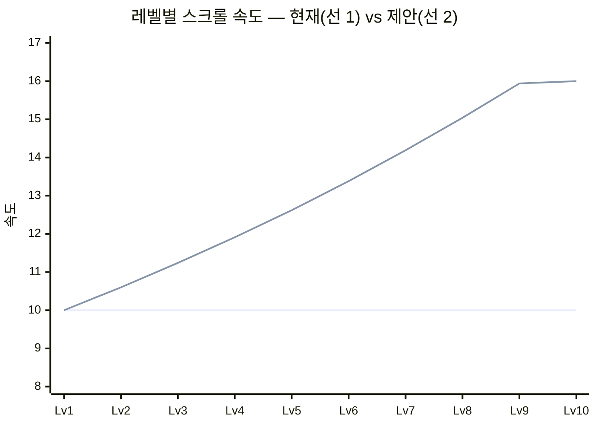

# 04. 레벨 디자인 기획서 — 봄 들판 (Main 씬)

> 문서 세트: [목차](Proposal.md) · [01 컨셉](01_Concept.md) · [02 시스템](02_System.md) · [03 전투·개체](03_Combat_Entity.md) · **04 레벨 디자인** · [05 밸런스](05_Balance.md)
> 데이터: [`05_Balance/level_curve.csv`](05_Balance/level_curve.csv)

---

## 1. 스테이지 콘셉트
| 항목 | 내용 |
|---|---|
| 이름 | 봄 들판 (Main 씬) |
| 구조 | 끝없이 이어지는 공중 발판, 아래는 떨어지면 끝나는 영역 |
| 목표 | 코인을 최대한 많이 모으며 오래 달리기 |
| 리듬 의도 | "코인 발판(보상) → 달팽이 발판(위협)"이 번갈아 와서 긴장과 보상이 교차 |

## 2. 화면 · 발판 배치 (옆에서 본 모습)
```
 y
 1.5 ┤                       ▀▀▀▀▀▀▀▀ (코인)          ← 발판 높이 범위
     │      🐰                                ▀▀▀▀▀▀▀▀ 🐌
-3.5 ┤ ▀▀▀▀▀▀▀▀                                         ← (가장 낮은 발판)
     │░░░░░░░░░░░░░░ 떨어지면 게임오버 (Dead 영역) ░░░░░░░░
     └──────────────────────────────────────────────────→ x
        플레이어 고정               발판 생성 x = 20 →  ← 10 m/s로 다가옴
```
| 요소 | 값 |
|---|---|
| 발판 생성 위치 | x = 20, 높이 -3.5 ~ 1.5 랜덤 |
| 발판 생성 간격 | 1.25 ~ 2.25초 → 발판 시작점 사이 거리 12.5 ~ 22.5 |
| 발판 너비 | 약 8.4 → 빈 틈 4.1 ~ 14.1 |
| 발판 종류 | 달팽이 발판 / 코인 발판 (각각 풀 3개) |

## 3. 스폰 테이블 — bag 방식
**현재:** 주머니에 [달팽이 1, 코인 1]을 넣고 섞어서 하나씩 꺼냄 → 다 꺼내면 다시 채움.

| 방식 | 같은 종류 최대 연속 | 장점 | 단점 |
|---|---|---|---|
| 완전 랜덤 (50%) | 제한 없음 (5연속 달팽이도 가능) | 예측 불가 | 운이 나쁜 판 · 좋은 판 차이가 큼 |
| **bag (현재)** | **2** | 랜덤하지만 공정, 보상이 너무 늦게 오지 않음 | 패턴을 눈치채면 쉬워짐 |

**💡 제안 — 레벨별 bag 구성 변경** (`level_curve.csv`)
| 레벨 | 필요 코인 | bag 구성 (달팽이 : 코인) | 달팽이 비율 | 스크롤 속도 | 단계 |
|---|---|---|---|---|---|
| 1 ~ 2 | 0 ~ 5 | 1 : 2 | 33% | 10 → 10.6 | 학습 — 코인을 먼저 많이 줘서 재미 붙이기 |
| 3 ~ 5 | 10 ~ 20 | 2 : 2 | 50% | 11.2 → 12.6 | 현재 난이도 |
| 6 ~ 9 | 25 ~ 40 | 3 : 2 | 60% | 13.4 → 15.9 | 위기 — 공격을 적극적으로 써야 함 |
| 10 ~ | 45 ~ | 3 : 2 | 60% | 16 (상한) | 한계 — 기록 경쟁 |

## 4. 난이도 곡선

- 현재는 레벨이 올라도 글자 · 효과만 바뀌어 **레벨업 = 보상만 있고 도전은 없음**
- 제안 곡선: 레벨마다 속도 × 1.06 (상한 16), 3 · 6레벨에서 달팽이 비율이 계단식으로 오름 → "레벨업 = 새 구간 진입" 느낌

## 5. 기믹 · 오브젝트 (💡 제안)
| 기믹 | 등장 | 효과 |
|---|---|---|
| 무너지는 발판 | 레벨 4 ~ | 밟고 0.8초 뒤 떨어짐 → 머무르지 말고 계속 뛰게 |
| 당근 상자 | 랜덤 | 먹으면 5초간 당근 3갈래 발사 |
| 황금 코인 | 10% | +5점 → 위험한 높이에 배치해 도전 유도 |

## 6. 검증 방법
[`Simulation.html`](Simulation.html)의 "bag / 완전 랜덤" 전환과 "레벨마다 속도 +8%" 체크로 배치 · 속도 변화를 직접 비교할 수 있어요. 오른쪽 패널의 "같은 종류 최대 연속" 숫자를 보면 bag의 효과가 바로 보여요.
