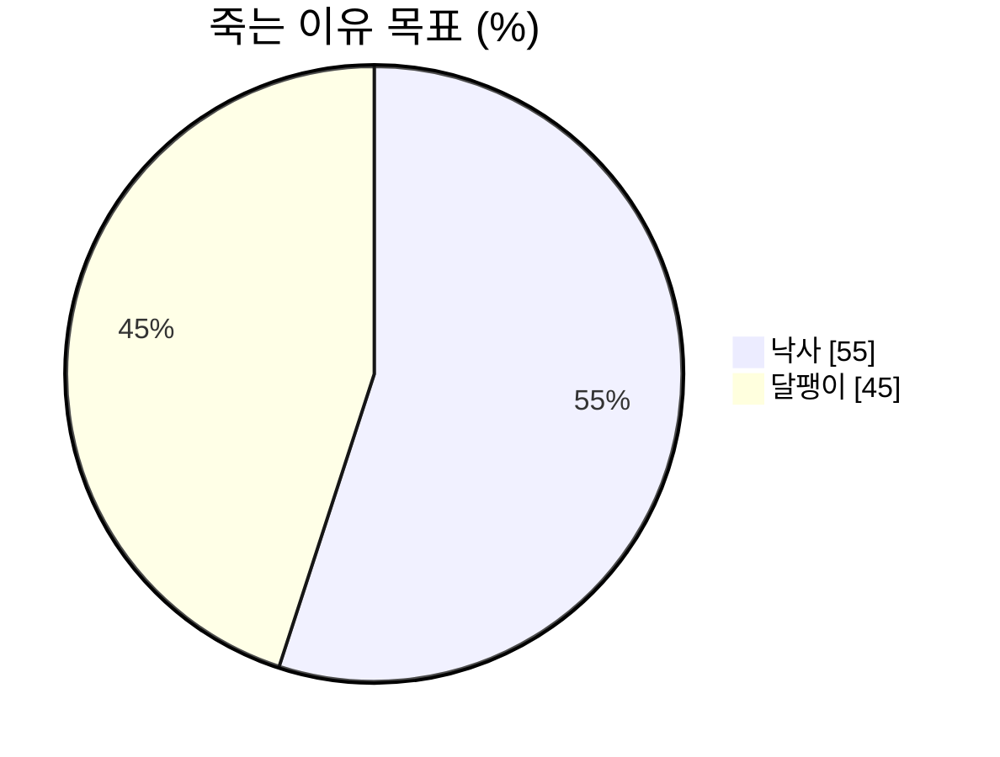

# 로그 · 지표 설계 — BunnyRunning

> 문서 세트: [목차](Proposal.md) · 기획: [컨셉](Concept.md) · [시스템](System.md) · [전투·개체](Combat_Entity.md) · [레벨 디자인](LevelDesign.md) · [밸런스](Balance.md) · 사업·운영: [사업 검토](Business.md) · [요구사항·로드맵](Requirements.md) · [Business Model](Monetization.md) · [서버·데이터](Server_Data.md) · [리소스](Resources.md) · **로그·지표** · [QA·출시](QA_Release.md) · [라이브 운영](LiveOps.md) · [사업화·법무](Business_Legal.md) · [needFix](needFix.md)

> **문서 정보** · 문서 번호 `D10-LOG` · 버전 v1.0 · 상태 `Draft` · 담당 기획자 · 클라이언트 개발자 · 최종 수정 2026-11-21 · 관련 문서 [사업 검토](Business.md) · [Business Model](Monetization.md)

**변경 이력**

| 버전 | 날짜 | 변경 내용 | 사유 | 결정자 | 영향 범위 |
|---|---|---|---|---|---|
| v1.0 | 2026-11-21 | 최초 작성 | — | 기획자 | — |

---

## 1. 목적
출시 후 **무엇을 측정할지** 정하는 문서예요.
> 지금 구현: 로그 없음. `com.unity.analytics` 3.8.2가 들어 있지만 쓰지 않아요. WebGL(앱인토스)에서 쓸 수 있는 도구를 정해요 → [F-07](needFix.md#8-정할-것)

## 2. 이름 규칙
- 이벤트 `evt_대상_동작`, 파라미터 `snake_case`
- 공통 값: `app_version`, `channel`(ait / itch / gamejolt), `session_id`
- 개인정보는 넣지 않아요.

## 3. 이벤트 목록
| 이벤트 | 발생 시점 | 파라미터 | 확인할 지표 |
|---|---|---|---|
| `evt_session_start` | `Intro` 씬 시작 | first_open | DAU · D1 재접속률 |
| `evt_run_start` | `Main` 시작 · 다시 시작 | run_index(오늘 몇 번째 판) | 하루 판 수 |
| `evt_run_end` | `GM.OnPlayerDead` | score, best, coins, level, play_sec, death_cause(fall / snail) | 한 판 시간 ([S-14](needFix.md)) · 죽는 이유 |
| `evt_level_up` | `LM` 레벨업 | level, play_sec | 첫 레벨업까지 시간 ([S-14](needFix.md)) |
| `evt_carrot_throw` | 당근 발사 | hit(bool) | 쿨다운 조정 ([S-03](needFix.md)) |
| `evt_jump` | 판 끝 1회 요약 | jumps, air_jumps | 공중 점프 사용 비율 ([S-06](needFix.md)) |
| `evt_ad_show` | 전면 · 배너 표시 | placement | 광고 노출 / DAU |
| `evt_ad_reward` | 이어하기 보상 | — | 보상형 시청률 |
| `evt_best_update` | 최고 점수 갱신 | old, new | 기록 갱신 빈도 |

## 4. 지표 ↔ 이벤트
| 지표 ([사업 검토](Business.md) §5) | 계산 |
|---|---|
| 한 판 평균 시간 | `evt_run_end.play_sec` 평균 |
| 하루 판 수 | `evt_run_start` 수 ÷ DAU |
| 죽는 이유 비율 | `death_cause` 비율 — 낙사가 너무 적으면 [S-06](needFix.md)이 맞는지 확인 |
| 보상형 시청률 | `evt_ad_reward` ÷ `evt_run_end` |

**[원그래프] 죽는 이유 목표 (예시)**

## 5. 완료 기준
- 베타 빌드에서 이벤트가 분석 도구에 들어온다.
- 개인정보처리방침에 분석 도구를 적었다.
