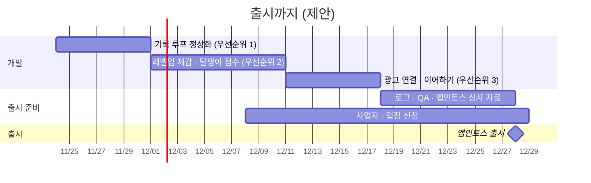

# 사업 검토 — BunnyRunning

> 문서 세트: [목차](Proposal.md) · 기획: [컨셉](Concept.md) · [시스템](System.md) · [전투·개체](Combat_Entity.md) · [레벨 디자인](LevelDesign.md) · [밸런스](Balance.md) · 사업·운영: **사업 검토** · [요구사항·로드맵](Requirements.md) · [BM·경제](Monetization.md) · [서버·데이터](Server_Data.md) · [리소스](Resources.md) · [로그·지표](Analytics.md) · [QA·출시](QA_Release.md) · [라이브 운영](LiveOps.md) · [사업화·법무](Business_Legal.md) · [needFix](needFix.md)

> **문서 정보** · ID `D01-BIZ` · v1.0 · 상태 `Draft` · Owner ME (기획 · 개발) · 최종 수정 2026-11-21 · 관련 `D01-CONCEPT`, `D07-BM`, `D13-LEGAL`

**변경 이력**

| 버전 | 날짜 | 변경 내용 | 사유 | 결정자 | 영향 범위 |
|---|---|---|---|---|---|
| v1.0 | 2026-11-21 | 최초 작성 | 사내 문서 기준 v3 적용 | ME | 문서만 |

---

## 1. 이 문서의 역할
이 게임을 **출시까지 만들 가치가 있는지** 판단하는 문서예요. 나중에 사업계획서 · 정부지원사업 신청서의 원본으로도 써요.
게임 내용은 [컨셉](Concept.md)에, 정해야 할 것은 [needFix](needFix.md) 8절에 있어요. 이 문서의 숫자는 **목표 · 가정**이에요.

## 2. 한 장 요약
| 항목 | 내용 | 상태 |
|---|---|---|
| 게임 이름 | BunnyRunning | 확정 (상표 확인 필요 → [사업화 · 법무](Business_Legal.md)) |
| 한 줄 정의 | 누르는 시간만큼 뛰어오르는 토끼가 발판을 건너고 당근으로 달팽이를 물리치는 2D 무한 러너 | 확정 ([컨셉](Concept.md)) |
| 최종 방향 | 한 손 · **30 ~ 45초** 고회전 기록 도전, "아깝다, 한 판 더" | needFix §7 결정 |
| 장르 | 하이퍼 ~ 하이브리드 캐주얼 러너 | 확정 |
| 플랫폼 · 유통 | **앱인토스(토스 미니앱 · WebGL)** — SDK 연동됨 / itch.io · Game Jolt — 소개 자료 있음 (`StoreImages/`) | 채널 우선순위 결정 → [F-01](needFix.md#8-사내-문서-기준-v3-적용-후-정할-것) |
| 타깃 | 한 손으로 틈틈이 즐기는 모바일 캐주얼 유저, 광고 기반 무료 게임 이용자 | 확정 |
| 수익 모델 | 광고 (배너 · 전면 · 보상형 이어하기) → [BM · 경제](Monetization.md) | 확정 방향 |

## 3. 유통 채널 비교
| 채널 | 수익 | 장점 | 확인할 것 |
|---|---|---|---|
| 앱인토스 | 토스 광고 (SDK `AITBannerAd` · `AIT.ShowFullScreenAd`) | 토스 사용자에게 바로 노출, 설치 없이 실행 | 입점 자격(사업자 필요 여부) · 심사 기준 · 광고 정산 조건 |
| itch.io · Game Jolt | 무료 배포 · 후원 | 빠른 공개 · 피드백 | 광고 SDK가 동작하지 않음 → 광고 없는 빌드 따로 |
| Google Play · App Store | 광고 네트워크 · 인앱결제 | 가장 큰 시장 | 광고 SDK 교체 필요 (토스 SDK는 앱인토스 전용) |

## 4. 경쟁작 비교
> 유형으로 적었어요. 실제 게임 3개를 골라 채워 주세요 → [F-02](needFix.md#8-사내-문서-기준-v3-적용-후-정할-것)

| 유형 | 보통의 BM | 이 게임의 차별점 |
|---|---|---|
| 수집형 러너 (쿠키런 류) | 캐릭터 · 펫 판매 | **점프 높이 조절 + 던지는 공격**, 30초짜리 짧은 판 |
| 원버튼 하이퍼 캐주얼 러너 | 광고 | 공격이 있어 피하기 · 처치를 고름 |
| 토스 미니게임 | 광고 · 포인트 | 기록 도전형 재도전 |

## 5. 목표 지표 (KPI) — 가정
| 지표 | 목표 (예시값) | 확인 방법 |
|---|---|---|
| 한 판 평균 시간 | 30 ~ 45초 | [로그](Analytics.md) `evt_run_end.play_sec` (needFix S-14) |
| 하루 1인당 판 수 | 8판 | `evt_run_start` |
| D1 재접속률 | 25% | `evt_session_start` |
| 전면 광고 노출 / DAU | 2회 | `evt_ad_show` |
| 보상형 이어하기 시청률 | 판의 15% | `evt_ad_reward` |

## 6. 개략 예산 (1인 개발)
| 항목 | 내용 |
|---|---|
| 인건비 | ME 1인 |
| 에셋 | 무료 · 구매 에셋 → [리소스](Resources.md) 라이선스 확인 |
| 유통 | 앱인토스 입점 비용 · 조건 확인, itch.io · Game Jolt 무료 |
| 서버 | 없음 (기록은 기기 저장) |
| 사업자 · 법무 | [사업화 · 법무](Business_Legal.md) |

## 7. 개략 일정
**[타임라인] 출시까지 (제안)**

> 읽는 법: 막대 = 작업 기간, 마름모 = 출시 순간이에요. 날짜는 제안이고 [요구사항 · 로드맵](Requirements.md)에서 관리해요.

## 8. 리스크와 대응
| 리스크 | 영향 | 대응 |
|---|---|---|
| 광고가 실제로 호출되지 않음 (S-01) | 출시해도 매출 0 | REQ 우선순위 3 → 출시 전 Must |
| 5단 점프로 낙사가 거의 없음 (S-06) | 긴장감 · 재도전 동기 약함 | 2단 점프 + 코요테 타임 (S-16) |
| 광고 피로 | 짧은 판 × 잦은 광고 = 이탈 | 첫 1 ~ 2판 광고 없음 (S-17) |
| 앱인토스 입점 조건 | 개인이면 입점 불가할 수 있음 | 사업자 등록 시점 결정 (F-12) |
| 개발용 패키지가 빌드에 포함 (OpenAI · MCP 플러그인) | 빌드 용량 · 보안 | 출시 빌드에서 제거 (F-06) |

## 9. 결정 (Gate P0 → P1)
- [ ] 1차 유통 채널 확정 (F-01)
- [ ] 경쟁작 3개 (F-02)
- [ ] 출시 목표일 (F-13)
