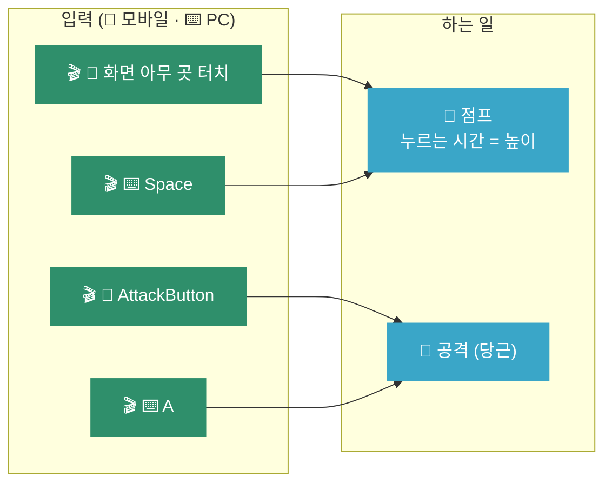
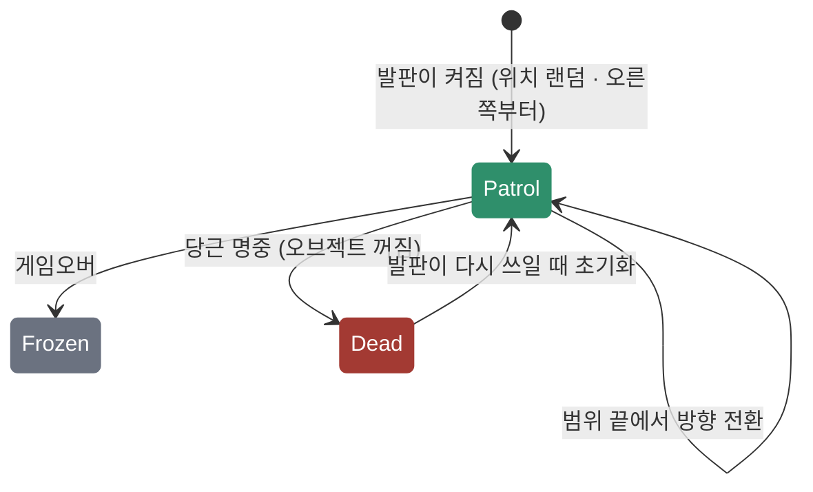
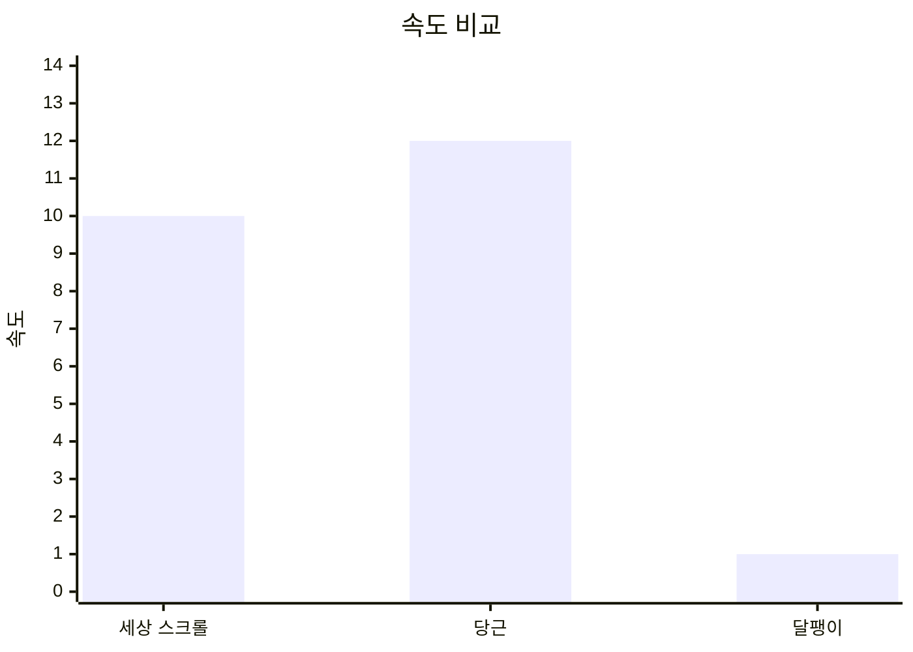
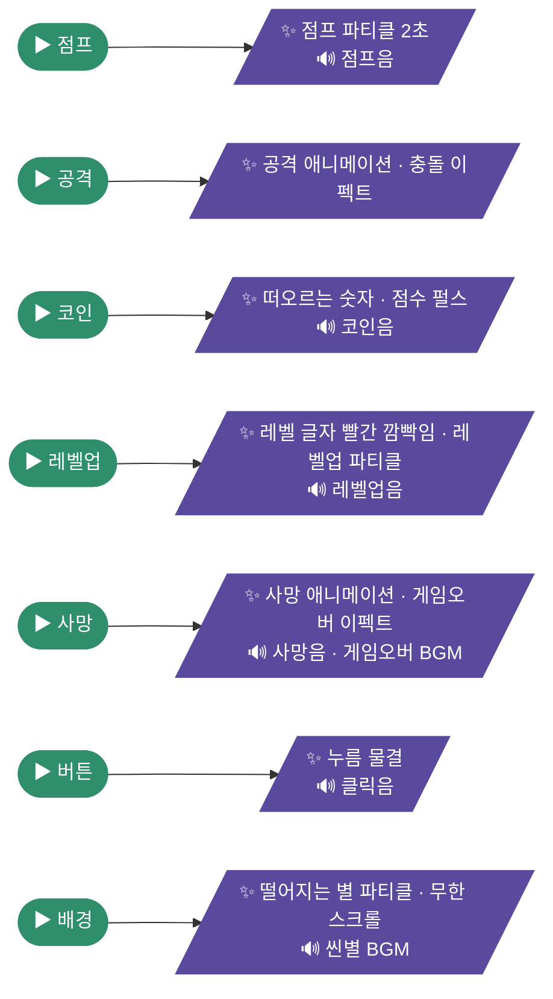

# 전투 · 캐릭터 · 몬스터

> 문서 세트: [목차](Proposal.md) · 기획: [컨셉](Concept.md) · [시스템](System.md) · **전투·개체** · [레벨 디자인](LevelDesign.md) · [밸런스](Balance.md) · 사업·운영: [사업 검토](Business.md) · [요구사항·로드맵](Requirements.md) · [Business Model](Monetization.md) · [서버·데이터](Server_Data.md) · [리소스](Resources.md) · [로그·지표](Analytics.md) · [QA·출시](QA_Release.md) · [라이브 운영](LiveOps.md) · [사업화·법무](Business_Legal.md) · [needFix](needFix.md)
> 모든 값은 코드 기본값 · 프리팹 · 프로젝트 설정 기준

> **문서 정보** · 문서 번호 `D04-ENTITY` · 버전 v1.0 · 상태 `Review` · 담당 기획자 · 아티스트 · 최종 수정 2026-11-21 · 관련 문서 [밸런스](Balance.md) · [리소스](Resources.md)

**변경 이력**

| 버전 | 날짜 | 변경 내용 | 사유 | 결정자 | 영향 범위 |
|---|---|---|---|---|---|
| v0.9 | 2026-11-20 | 기존 문서 (자세한 기록은 git 커밋) | — | 기획자 | — |
| v1.0 | 2026-11-21 | 문서 정보 · 변경 이력 · 문서 번호 추가, 사업 · 운영 문서와 연결 | — | 기획자 | 문서만 |

---

## 1. 조작
| 플랫폼 | 점프 | 공격 |
|---|---|---|
| 모바일 | 화면 아무 곳 터치 (누르는 시간 = 높이) | `AttackButton` |
| PC | Space (누르는 시간 = 높이) | A |

**[구성도] 조작 (입력 → 하는 일)**

> 읽는 법: 왼쪽 초록 = 누르는 것 (📱 모바일 · ⌨️ PC) → 오른쪽 파랑 = 게임에서 일어나는 일이에요.

## 2. 러너 (토끼, `Player`)
```
(옆에서 본 모습)
   world moves <<<<< 10 m/s

        B          <- 토끼는 x 고정, 세상이 왼쪽으로 흐름
   ===========
```

**[선그래프] 1회 점프 높이 (위 속도 12 · 중력 20)**
```mermaid
xychart-beta
  title "점프 높이"
  x-axis ["0초", "0.2", "0.4", "0.6", "0.8", "1.0", "1.2초"]
  y-axis "높이" 0 --> 4
  line [0, 2.0, 3.2, 3.6, 3.2, 2.0, 0]
```
> 읽는 법: 왼쪽 → 오른쪽이 시간이에요. 0.6초에 가장 높은 3.6, 1.2초에 착지해요. 그동안 세상은 왼쪽으로 12 흘러가요.

| 항목 | 값 | 근거 |
|---|---|---|
| 달리기 | 세상이 왼쪽으로 10 m/s | `ScrollingObject.speed` |
| 점프 힘 | 600 → 위 속도 12 | 씬 `Main` 값 (코드 기본값 700), 질량 1, 물리 간격 0.02초 |
| 중력 | 20 × 1 | `Physics2DSettings`, `Rigidbody2D.gravityScale` |
| 1회 점프 | 체공 1.2초 · 높이 3.6 · 수평 12 | 밸런스 §1 |
| 짧은 점프 | 떼는 순간 속도 × 0.5 | `Player.Update` |
| 점프 횟수 | 최대 5회 (`jumpCnt < 5`) | `Player.Update` |
| 착지 | 첫 접점 법선 y > 0.7 | `OnCollisionEnter2D` |
| 사망 | 'Dead' 태그 트리거 | `OnTriggerEnter2D` |

## 3. 공격 — 당근 (`CarrotProjectile`)
| 항목 | 값 |
|---|---|
| 속도 | 12 |
| 방향 | 조준 대상(`attackTarget`) 방향, 없으면 오른쪽 |
| 데미지 | 1 |
| 수명 | 5초 |
| 쿨다운 | 없음 |
| 판정 | 트리거, `IDamageable`만 반응 |
| 연출 | 공격 애니메이션, 충돌 이펙트 0.5초 |

```
cooldown 0 : >> >> >> >> >> >>   누르는 만큼 계속 나감
```

## 4. 몬스터 — 달팽이 (`SnailPatrol`)
```
        |<---- patrol ---->|
  ======@==================@======     @ = 달팽이 (속도 1)
  |<---------- platform ---------->|   발판 스프라이트 너비의 절반 범위를 왕복, 끝에서 방향 전환
```
| 항목 | 값 |
|---|---|
| 체력 | 당근 1발에 사라짐 (`Damage` → `Die`) |
| 이동 | 속도 1, 시작 위치 랜덤, 범위 끝에서 방향 전환 |
| 공격 | 닿으면 게임오버 ('Dead' 태그) |
| 처치 점수 | 없음 |
| 게임오버 | 이동 · 애니메이션 정지 |

**[상태도] 몬스터 — 달팽이 (SnailPatrol)**

> 읽는 법: 상자 = 상태, 화살표 위 글 = 상태가 바뀌는 조건이에요. 검은 점에서 시작해요.

**[막대그래프] 속도 비교**

> 읽는 법: 단위는 초당 이동 거리예요. 세상 10 · 당근 12 · 달팽이 1.

## 5. 코인 (`Coin`)
| 항목 | 값 |
|---|---|
| 배치 | 코인 발판 위 5개 (`CoinPlatform` 프리팹) |
| 효과 | 점수 +1 · 레벨 게이지 +1 |
| 연출 | "+n" 떠오르는 글자 (Pop → MoveUp → FadeOut) · 코인 소리 |

## 6. 이펙트 · 사운드
**[흐름도] 이펙트 · 사운드 (일이 생기면 → 보이고 들리는 것)**

> 읽는 법: 초록 = 이런 일이 생기면 → 보라 = ✨ 보이는 것 · 🔊 들리는 것이에요.

| 대상 | 이펙트 | 사운드 |
|---|---|---|
| 점프 | 점프 파티클 (2초) | 점프음 (플레이어 스피커) |
| 공격 | 공격 애니메이션 · 충돌 이펙트 | – |
| 코인 | 떠오르는 숫자 · 점수 펄스 | 코인음 |
| 레벨업 | 레벨 글자 빨간 깜빡임 · 레벨업 파티클 | 레벨업음 (전용 스피커) |
| 사망 | 사망 애니메이션 · 게임오버 이펙트 | 사망음 · 게임오버 BGM |
| 버튼 | 누름 물결 (`PressRippleEffect`) | 클릭음 |
| 배경 | 떨어지는 별 파티클 · 무한 스크롤 | 씬별 BGM |
