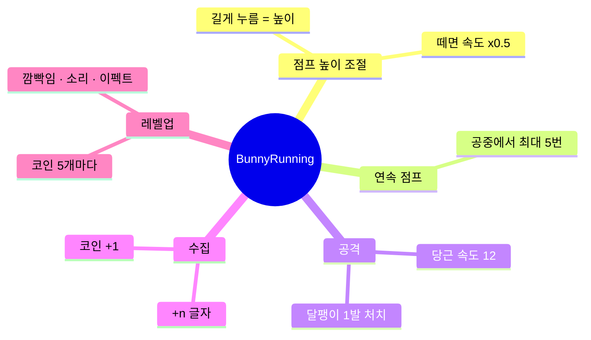
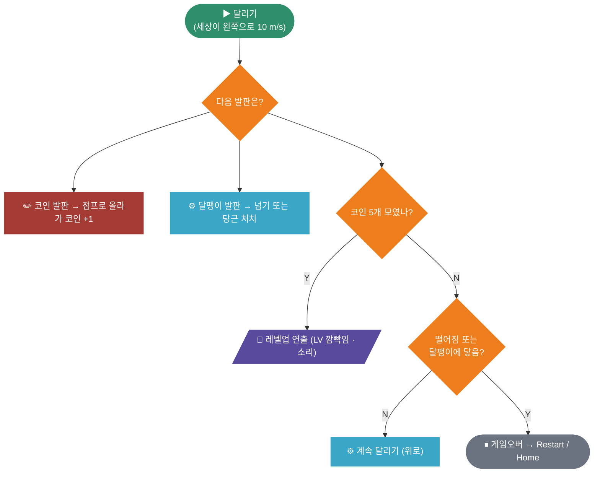

# 게임 컨셉 — BunnyRunning

> 문서 세트: [목차](Proposal.md) · 기획: **컨셉** · [시스템](System.md) · [전투·개체](Combat_Entity.md) · [레벨 디자인](LevelDesign.md) · [밸런스](Balance.md) · 사업·운영: [사업 검토](Business.md) · [요구사항·로드맵](Requirements.md) · [Business Model](Monetization.md) · [서버·데이터](Server_Data.md) · [리소스](Resources.md) · [로그·지표](Analytics.md) · [QA·출시](QA_Release.md) · [라이브 운영](LiveOps.md) · [사업화·법무](Business_Legal.md) · [needFix](needFix.md)

> **문서 정보** · 문서 번호 `D01-CONCEPT` · 버전 v1.0 · 상태 `Review` · 담당 기획자 · 최종 수정 2026-11-21 · 관련 문서 [사업 검토](Business.md) · [요구사항·로드맵](Requirements.md)

**변경 이력**

| 버전 | 날짜 | 변경 내용 | 사유 | 결정자 | 영향 범위 |
|---|---|---|---|---|---|
| v0.9 | 2026-11-20 | 기존 문서 (자세한 기록은 git 커밋) | — | 기획자 | — |
| v1.0 | 2026-11-21 | 문서 정보 · 변경 이력 · 문서 번호 추가, 사업 · 운영 문서와 연결 | — | 기획자 | 문서만 |

---

## 기획 의도
> 기획자가 정한 방향이에요. 아래 "개요"부터는 지금 코드 · 씬에 구현된 내용이에요.

| 항목 | 내용 |
|---|---|
| 한 줄 정의 | 누르는 시간만큼 뛰어오르는 토끼가 발판을 건너고 당근으로 달팽이를 물리치는 2D 무한 러너 |
| 기획 의도 (핵심 재미) | 길게 · 짧게 눌러 높이를 조절하는 점프 손맛, 한 판이 짧아 "한 판 더"가 쉬운 리듬 |
| 타깃 | 한 손으로 틈틈이 즐기는 모바일 캐주얼 유저, 광고 기반 무료 게임 이용자 |
| 플랫폼 · 제약 | 모바일 가로 화면(터치 점프 · 공격 버튼), 전면 · 배너 광고 |
| 레퍼런스 · 차별점 | 점프 · 수집형 러너(쿠키런 류) → **점프 높이 조절 + 던지는 공격**으로 피하기와 처치를 둘 다 고름 |

## 개요
| 항목 | 내용 | 근거 |
|---|---|---|
| 장르 | 2D 횡스크롤 러너 (세상이 자동으로 흐름) | `ScrollingObject`, `PlatformSpawner` |
| 플랫폼 | 모바일 가로 화면 · PC | `LandscapeMode`, `PlayerInput` |
| 엔진 | Unity 6 (6000.5.3f1) · C# · 새 Input System | `ProjectSettings`, `PlayerInput` |
| 실제 플레이어 | 씬 `Main`의 `UniRun_Run_0 (1)` (점프 힘 600) — `Player` 오브젝트는 꺼져 있음 | `Main.unity` |
| 사용 에셋 · SDK | Apps in Toss SDK(광고), Floating Text Engine Lite, Cartoon FX Remaster | `Assets/`, `AM` |
| 씬 | `Intro` → `Main` (`protocal`은 테스트 씬) | 빌드 설정 |
| 출시 자료 | itch.io / Game Jolt 스토어 이미지 · 소개글 | `StoreImages/` |

## 재미 요소 (코드에서 확인되는 것)
| 요소 | 내용 | 코드 근거 |
|---|---|---|
| 점프 높이 조절 | 길게 누르면 높이, 올라가는 중에 떼면 속도 × 0.5 | `Player.Update` |
| 연속 점프 | 공중에서 최대 5번 | `jumpCnt < 5` |
| 공격 | 당근을 던져 달팽이 처치 | `CarrotProjectile`, `SnailPatrol` |
| 수집 | 코인 +1, "+n" 글자가 떠오름 | `Coin`, `FloatEffect` |
| 레벨업 | 코인 5개마다 레벨 글자 깜빡임 · 소리 · 이펙트 | `LM` |

**점프 높이 조절 (옆에서 본 모습)**
```
(1) 길게 누름: 위 속도 12 그대로
            .-'''''-.
         .-'         '-.        최고 높이 3.6 · 체공 1.2초
       .'               '.
  B __/                   \__

(2) 짧게 누름: 올라가는 중에 떼면 속도 x0.5
          .-'''-.
       .-'       '-.           더 낮고 짧은 점프
  B __/             \__

B = 토끼
```

**달팽이를 만났을 때**
```
         jump over
      .-'''''''-.
  B _/           \_    @  ======       점프로 넘기

  B  >>> carrot >>>    @  ======       당근으로 처치 (데미지 1 = 사라짐)

@ = 달팽이 (닿으면 게임오버)
```

**[마인드맵] 재미 요소 한눈에**


## 코어 루프

**[흐름도] 코어 루프**


## 화면에 있는 요소
위치는 씬에서 확인하세요. 아래는 코드 · 씬에 있는 요소 목록이에요.

**Intro**
 - 시작 버튼 (SCM)
 - 가이드 버튼 · 가이드 창
 - Intro BGM

**Main**
 - scoreText "Score: n"
 - levelText "LV. n"
 - AttackButton
 - 떨어지는 별 파티클
 - Main BGM

**Game Over**
 - gameoverUI
 - resultScoreText "BEST Score: n"
 - Restart · Home 버튼 (SCM)
 - 게임오버 이펙트 · BGM
 - scoreText · levelText · AttackButton 숨김
| 입력 | PC | 모바일 |
|---|---|---|
| 점프 | Space | 화면 터치 (`GetMouseButtonDown(0)`, 화면 어디든) |
| 공격 | A | `AttackButton` |

## 광고 (코드에 있는 것)
| 광고 | 함수 | 조건 |
|---|---|---|
| 배너 | `AM.ShowBanner()` / `HideBanner()` | 하단 (`AITBannerPosition.Bottom`) |
| 전면 | `AM.OnGameOver()` | 사망 3번마다, 로드 완료된 경우만 |

> 이 함수들을 부르는 곳이 아직 없어요 → [S-01](needFix.md)

## 개발 현황
| 구분 | 내용 |
|---|---|
| 구현됨 | 점프(높이 조절 · 5회) · 당근 공격 · 달팽이 · 코인 · 레벨업 · 발판 풀링 · bag 배치 · 무한 배경 · 씬별 BGM · 게임 가이드 · 가로 화면 고정 · 광고 함수 |
| 다음 할 일 | [needFix](needFix.md) |
