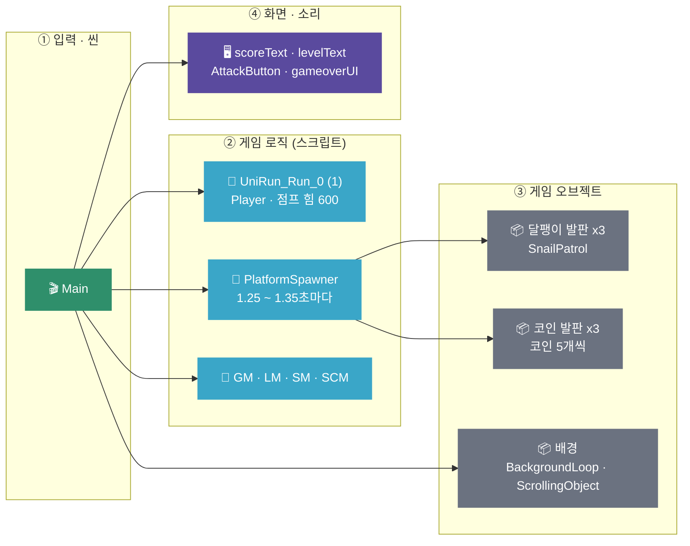
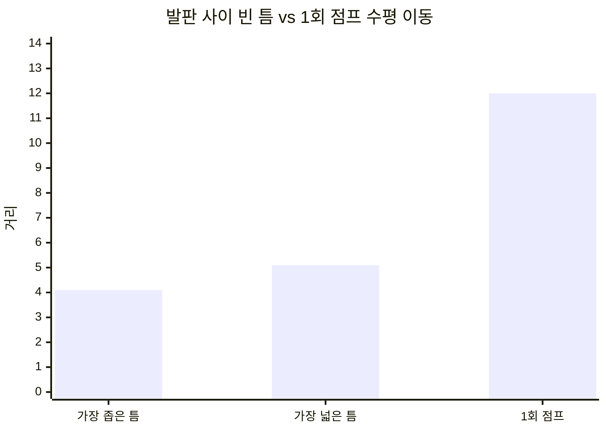
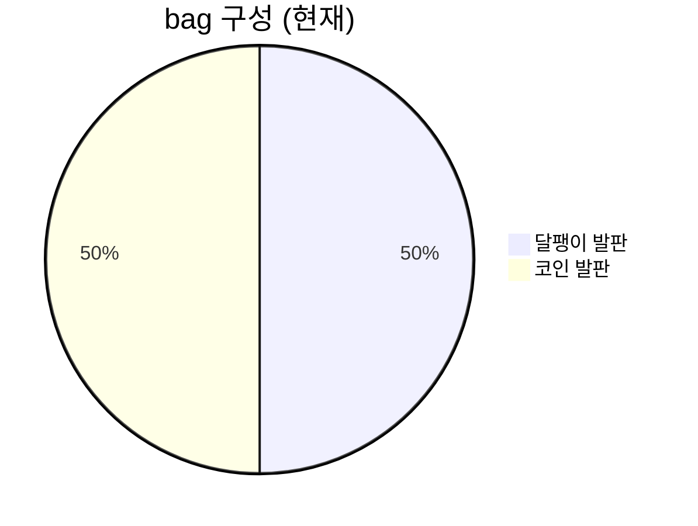

# 레벨 디자인 — Main 씬

> 문서 세트: [목차](Proposal.md) · 기획: [컨셉](Concept.md) · [시스템](System.md) · [전투·개체](Combat_Entity.md) · **레벨 디자인** · [밸런스](Balance.md) · 사업·운영: [사업 검토](Business.md) · [요구사항·로드맵](Requirements.md) · [BM·경제](Monetization.md) · [서버·데이터](Server_Data.md) · [리소스](Resources.md) · [로그·지표](Analytics.md) · [QA·출시](QA_Release.md) · [라이브 운영](LiveOps.md) · [사업화·법무](Business_Legal.md) · [needFix](needFix.md)
> 데이터: [`Balance/platform.json`](Balance/platform.json)

> **문서 정보** · ID `D05-LEVEL` · v1.0 · 상태 `Review` · Owner ME (기획 · 개발) · 최종 수정 2026-11-21 · 관련 `D06-BAL`

**변경 이력**

| 버전 | 날짜 | 변경 내용 | 사유 | 결정자 | 영향 범위 |
|---|---|---|---|---|---|
| v0.9 | 2026-11-20 | 기존 문서 (자세한 기록은 git 커밋) | — | ME | — |
| v1.0 | 2026-11-21 | 문서 정보 · 변경 이력 · 문서 ID 추가, 문서 세트에 사업·운영 문서 연결 | 사내 문서 기준 v3 적용 | ME | 문서만 (게임 코드 · 데이터 변경 없음) |

---

## 1. 구성
| 항목 | 내용 | 근거 |
|---|---|---|
| 씬 | `Main` | 빌드 설정 |
| 구조 | 공중 발판이 오른쪽(x = 20)에서 생겨 왼쪽으로 흐름, 아래는 'Dead' 영역 | `PlatformSpawner`, `Player` |
| 배경 | 무한 스크롤 | `BackgroundLoop`, `ScrollingObject` |
| 목표 | 코인을 모으며 오래 달리기 | `GM`, `LM` |

**[구성도] Main 씬 구성**

> 읽는 법: 상자 = 씬 · 스크립트 · 오브젝트, 화살표 위 글 = 보내는 신호나 하는 일이에요. ①②③은 일어나는 순서예요.

## 2. 발판 배치 (옆에서 본 모습)
```
 y
 1.0 ┤                       ▀▀▀▀▀▀▀▀ (코인)          ← 발판 높이 범위
     │      🐰                                ▀▀▀▀▀▀▀▀ 🐌
-3.5 ┤ ▀▀▀▀▀▀▀▀                                         ← (가장 낮은 발판)
     │░░░░░░░░░░░░░░ 떨어지면 게임오버 (Dead 영역) ░░░░░░░░
     └──────────────────────────────────────────────────→ x
        플레이어 고정               발판 생성 x = 20 →  ← 10 m/s로 다가옴
```
| 요소 | 값 |
|---|---|
| 발판 생성 위치 | x = 20, 높이 -3.5 ~ 1 랜덤 (씬 값) |
| 발판 생성 간격 | 1.25 ~ 1.35초 (씬 값, 코드 기본값 2.25) |
| 발판 너비 (콜라이더) | 8.41 |
| 발판 종류 | 달팽이 발판 / 코인 발판 (각각 풀 3개) |

**발판 사이 거리**
```
[=========A=========]                     [=========B=========]
|<------ 8.41 ----->|<--- gap 4.1~5.1 --->|
|<------------- 12.5 ~ 13.5 ------------->|

A 시작 ~ B 시작 = 생성 간격(1.25 ~ 1.35초) x 스크롤 10 m/s
빈 틈 = 그 거리 - 발판 너비 8.41
```

**[막대그래프] 발판 사이 빈 틈 vs 1회 점프 수평 이동**

> 읽는 법: 1회 점프(12)가 가장 넓은 틈(5.1)보다 길어요.

## 3. 스폰 테이블 — bag 방식
주머니에 [달팽이 1, 코인 1]을 넣고 섞어서 하나씩 꺼냄 → 다 꺼내면 다시 채움.

| 항목 | 값 |
|---|---|
| bag 구성 | 달팽이 1 : 코인 1 |
| 달팽이 비율 | 50% |
| 같은 종류 최대 연속 | 2 |

```
result : S C | C S | S C | C S
               ^^^^^ 같은 종류는 최대 2번 연속
```

**[원그래프] bag 구성 (현재)**

> 읽는 법: 조각이 클수록 비율이 커요.

## 4. 난이도
현재는 레벨이 올라도 스크롤 속도 · 발판 구성이 그대로예요. 레벨업은 글자 · 소리 · 이펙트만 바뀌어요.

| 레벨 | 필요 코인 (누적) | 스크롤 속도 | bag (달팽이 : 코인) |
|---|---|---|---|
| 모든 레벨 | 5개마다 +1 | 10 | 1 : 1 |

> 레벨에 따라 어려워지는 곡선은 [S-07](needFix.md)
