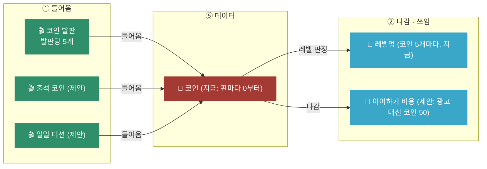

# Business Model — BunnyRunning

> 문서 세트: [목차](Proposal.md) · 기획: [컨셉](Concept.md) · [시스템](System.md) · [전투·개체](Combat_Entity.md) · [레벨 디자인](LevelDesign.md) · [밸런스](Balance.md) · 사업·운영: [사업 검토](Business.md) · [요구사항·로드맵](Requirements.md) · **Business Model** · [서버·데이터](Server_Data.md) · [리소스](Resources.md) · [로그·지표](Analytics.md) · [QA·출시](QA_Release.md) · [라이브 운영](LiveOps.md) · [사업화·법무](Business_Legal.md) · [needFix](needFix.md)

> **문서 정보** · 문서 번호 `D07-BM` · 버전 v1.0 · 상태 `Draft` · 담당 기획자 · 대표 · 최종 수정 2026-11-21 · 관련 문서 [밸런스](Balance.md) · [서버·데이터](Server_Data.md)

**변경 이력**

| 버전 | 날짜 | 변경 내용 | 사유 | 결정자 | 영향 범위 |
|---|---|---|---|---|---|
| v1.0 | 2026-11-21 | 최초 작성 | — | 기획자 | — |

---

## 1. 목적
**어떻게 돈을 벌고, 코인이 어떻게 도는지** 정하는 문서예요.
> 지금 구현: 토스 광고 매니저 `AM`이 있지만 **부르는 곳이 없어** 광고가 나오지 않아요 (needFix [S-01](needFix.md)). 코인은 점수 · 레벨업에만 쓰여요.

## 2. Business Model 구조
| 항목 | 결정 | 이유 |
|---|---|---|
| 주 수익원 | **광고** (전면 · 배너 · 보상형) | 30 ~ 45초 판 · 잦은 재시작 = 광고 지면이 많음, 타깃이 광고형 무료 게임 이용자 |
| 인앱결제 | 1차 출시엔 없음 | 1인 개발 · 서버 없음. 스킨 상점([S-11](needFix.md))은 보류 |
| 넣지 않는 것 | 가챠 · 랜덤 박스 | 확률 공개 의무 · 운영 부담 |

## 3. 재화 순환 — 코인
**[구성도] 코인 흐름 (지금 + 제안)**


## 4. 광고 지면
| 지면 ID | 종류 | 위치 | 규칙 | 지금 |
|---|---|---|---|---|
| `AD_BANNER` | 배너 | 게임 화면 하단 (`AITBannerPosition.Bottom`) | 플레이 중 점프 · 공격 버튼을 가리지 않는지 확인 | 함수만 있음 |
| `AD_INTER` | 전면 | 게임오버 → 다시 시작 사이 | **사망 3번마다** (`showEveryDeaths = 3`), 첫 1 ~ 2판 없음, 이어하기 직후 연속 노출 금지 | 함수만 있음 |
| `AD_CONTINUE` | 보상형 | 게임오버 창 | 끝까지 보면 같은 점수로 이어서 달리기, **판당 1회** | 주석 처리됨 (`rewardedId`) |

**[타임라인] 한 사람의 5판 (제안 규칙)**

```mermaid
gantt
  title 5판 동안 광고
  dateFormat x
  axisFormat %S초
  section 판
  1판 :a1, 0, 40000ms
  2판 :a2, 40000, 40000ms
  3판 :a3, 80000, 40000ms
  4판 :a4, 120000, 40000ms
  5판 :a5, 160000, 40000ms
  section 광고
  3번째 사망 전면 광고 :crit, milestone, d1, 120000, 0ms
```


## 5. 광고 ID 관리
| 환경 | 배너 | 전면 | 보상형 |
|---|---|---|---|
| 개발 (지금) | `ait-ad-test-banner-id` | `ait-ad-test-interstitial-id` | `ait-ad-test-rewarded-id` (주석) |
| 출시 | 앱인토스 콘솔에서 발급 | 발급 | 발급 |

> 출시 빌드에 테스트 ID가 남지 않게, ID는 씬 값이 아니라 **빌드 설정(개발 / 출시)**으로 나눠요 ([REQ_111](Requirements.md)).

## 6. 매출 시뮬레이션 (가정)
```
일 매출 = 전면 + 배너 + 보상형

예) DAU 1,000명 · 1인 하루 8판
  전면   : 8판 중 사망 3번마다 → 약 2회 × 1,000 ÷ 1,000 × eCPM ₩3,000  = ₩6,000
  보상형 : 판의 15% = 1.2회 × 1,000 ÷ 1,000 × eCPM ₩8,000           = ₩9,600
  배너   : 1인 하루 노출 약 8회 × 1,000 ÷ 1,000 × eCPM ₩300          = ₩2,400
  합계 약 ₩18,000 / 일 → 약 ₩54만 / 월
```
> eCPM과 정산 비율은 **앱인토스 광고 조건에 따라 달라요.** 위 값은 계산 방법을 보여 주는 가정이에요 → 입점 조건 확인 후 바꿔 넣어요.

## 7. 예외 처리
| 상황 | 처리 |
|---|---|
| 광고 로드 실패 | 경고 로그만, 게임 진행 (지금 동작) · 이어하기 버튼은 비활성 |
| 광고 시청 중 앱 전환 · 종료 | 보상 없음, 이어하기 기회는 남겨 둠 |
| 토스 밖(itch.io · PC)에서 실행 | 광고 호출을 건너뛰는 빌드 설정 |

## 8. 법 · 플랫폼 확인
| 항목 | 이 게임 | 상태 |
|---|---|---|
| 확률형 아이템 | 없음 | 해당 없음 |
| 앱인토스 광고 정책 | 노출 빈도 · 위치 · 아동 대상 여부 | 확인 필요 |
| 개인정보 | 광고 SDK가 수집하는 정보 → 개인정보처리방침 | 확인 필요 |
