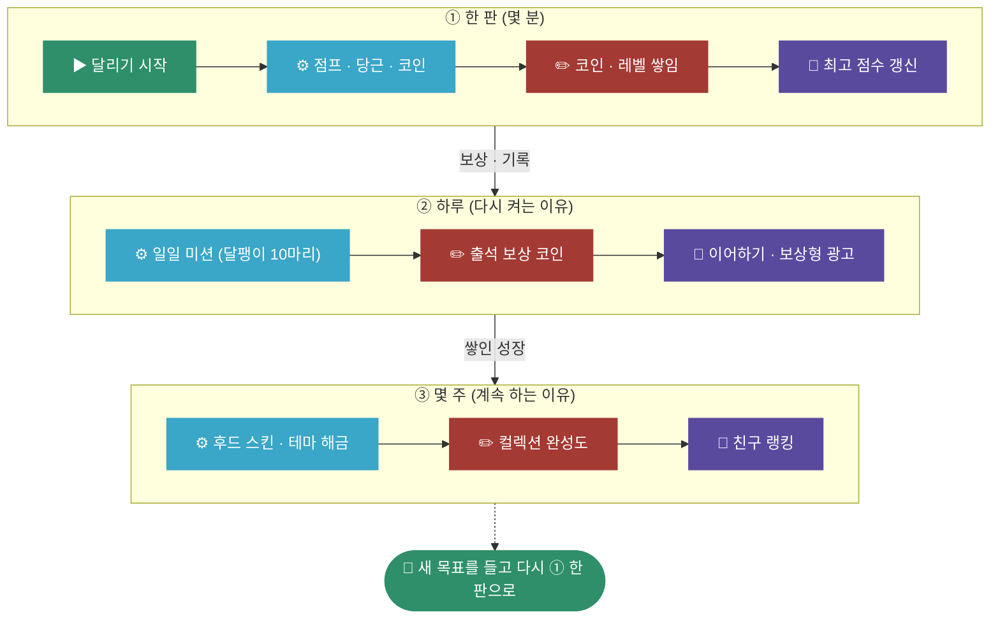

# needFix — 고칠 점 · 부족한 점 · 제안

> 문서 세트: [목차](Proposal.md) · 기획: [컨셉](기획/Concept.md) · [시스템](기획/System.md) · [전투·개체](기획/Combat_Entity.md) · [레벨 디자인](기획/LevelDesign.md) · [밸런스](기획/Balance.md) · 사업·운영: [사업 검토](대표/Business.md) · [요구사항·로드맵](기획/Requirements.md) · [Business Model](기획/Monetization.md) · [서버·데이터](개발/Server_Data.md) · [리소스](디자인/Resources.md) · [로그·지표](기획/Analytics.md) · [QA·출시](QA/QA_Release.md) · [라이브 운영](운영/LiveOps.md) · [사업화·법무](대표/Business_Legal.md) · **needFix**
> 컨셉 ~ 밸런스 문서는 현재 구현만 담고, 바꾸자는 내용은 모두 여기에 모았어요. 반영하면 상태를 **완료**로 바꾸고 컨셉 ~ 밸런스 문서의 값을 고쳐 주세요. 사업 · 운영 문서(계획 · 초안)에서 나온 **정할 것**은 8절에 있어요.

> **문서 정보** · 문서 번호 `D00-FIX` · 버전 v1.2 · 상태 `Review` · 담당 기획자 · 최종 수정 2026-11-21

**변경 이력**

| 버전 | 날짜 | 변경 내용 | 사유 | 결정자 | 영향 범위 |
|---|---|---|---|---|---|
| v0.9 | 2026-11-20 | 기존 문서 (자세한 기록은 git 커밋) | — | 기획자 | — |
| v1.0 | 2026-11-21 | 문서 정보 · 변경 이력 · 문서 번호 추가, 사업 · 운영 문서와 연결, Suggestions에서 이름 변경 | — | 기획자 | 문서만 |
| v1.1 | 2026-11-21 | 기업용 기획 가이드에 있지만 아직 적용 안 된 항목(결정 로그 · 용어집) 추가 | 가이드 흐름과 비교 | 기획자 | 문서만 |
| v1.2 | 2026-11-21 | 공통 관리 항목 반영 (용어집 · 결정 로그 작성, 단계별 Gate 작성 · 미통과 표시) | 기업용 기획 가이드 흐름 | 기획자 | 문서만 |

---

## 1. 버그 · 코드와 의도가 다른 부분
| ID | 현재 (코드 근거) | 문제 | 제안 | 관련 | 상태 |
|---|---|---|---|---|---|
| S-01 | `AM`이 Intro 씬에만 있고, `OnGameOver` · `ShowBanner`를 부르는 곳이 없음 | 광고가 나오지 않음 | `AM`을 `DontDestroyOnLoad`로 유지, `GM.OnPlayerDead()`에서 `AM.ins?.OnGameOver()`, Main 시작 시 `ShowBanner()` | 01 · 시스템 §3-7 | 대기 |
| S-02 | 게임오버 창 "BEST Score"에 이번 판 점수 표시, 저장 없음 | 최고 점수가 없음 | `PlayerPrefs("BestScore")` 비교 · 저장, "SCORE / BEST" 두 줄 | 시스템 §3-6 | 대기 |
| S-03 | 당근 쿨다운 없음 | 연타로 앞의 달팽이를 미리 다 지울 수 있음 | 쿨다운 0.4초 + 버튼 게이지 | 전투·개체 §3 | 대기 |
| S-04 | `SCM` 씬 이동에 중복 방지 없음 | 버튼 연타 시 코루틴 여러 개 | `isChanging` 잠금 | 시스템 §4 | 대기 |
| S-05 | `Coin.coinCnt`가 `static` | 판이 바뀌어도 떠오르는 숫자가 계속 커짐 | 새 판 시작 때 0으로 | 시스템 §4 | 대기 |
| S-06 | 점프 최대 5회 (README에는 "2단 점프") | 낙사가 거의 없음 (밸런스 §2: 가장 넓은 틈 5.1 vs 1회 점프 12 · 5회 점프 최대 60) | 의도 확인 후 2회로 조정 | 전투·개체 §2 · 밸런스 §2 | 결정 필요 |

## 2. 부족한 기능 · 밸런스 제안
### S-07 레벨별 난이도 곡선

현재는 모든 레벨이 속도 10 · bag 1 : 1 (레벨 디자인 §4).

```
스크롤 속도(레벨)  = min(16, 10 × 1.06^(레벨-1))
달팽이 : 코인      = 1:2 (Lv 1~2) → 2:2 (Lv 3~5) → 3:2 (Lv 6~)
빈 틈(레벨)        = 속도 × (1.25 ~ 1.35) - 8.41      (현재 씬의 생성 간격 기준)
```
| 레벨 | 1 | 3 | 5 | 7 | 10 |
|---|---|---|---|---|---|
| 속도 | 10 | 11.24 | 12.62 | 14.19 | 16 |
| 빈 틈 | 4.1 ~ 5.1 | 5.6 ~ 6.8 | 7.4 ~ 8.6 | 9.3 ~ 10.8 | 11.6 ~ 13.2 |
| 달팽이 비율 | 33% | 50% | 50% | 60% | 60% |

> S-06(2단 점프)과 같이 적용해도: 레벨 10 가장 넓은 틈 13.2 < 1회 점프 수평 이동 19.2 (1.2초 × 16) < 2단 점프 38.4

### S-08 달팽이 처치 점수
현재 처치 점수 0 → 공격할 이유가 약함. 처치 +3점 제안.

### S-09 몬스터 추가
```
(1) 꿀벌: 발판 사이 공중에서 위아래
      ~^~v~^~v~^~
     ====      ====

(2) 고슴도치: 당근에 안 죽음 -> 점프로만
      ===###===
```

### S-10 기믹
| 기믹 | 효과 |
|---|---|
| 무너지는 발판 | 밟고 잠시 뒤 떨어짐 → 머무르지 말고 계속 뛰게 |
| 당근 상자 | 먹으면 몇 초간 당근 3갈래 발사 |
| 황금 코인 | 높은 점수, 위험한 높이에 배치 |

### S-11 수익 · 장기 루프
| 제안 | 내용 |
|---|---|
| 보상형 광고 | 게임오버 때 "광고 보고 이어하기" 1회 |
| 코인 사용처 | 후드 스킨 구매 |

## 3. 확인 · 결정이 필요한 항목
| ID | 내용 | 필요한 것 |
|---|---|---|
| S-12 | 화면 배치(버튼 · 글자 위치)가 문서에 없음 | Intro · Main · 게임오버 화면 캡처를 컨셉에 추가 |
| S-13 | 한 줄 소개 · 타깃 유저 · 레퍼런스 게임 | 기획자가 정해서 컨셉에 추가 (README의 "한 줄 소개: 직접 작성" 칸) |
| S-14 | 한 판 평균 시간 · 첫 레벨업까지 걸리는 시간 | 플레이 테스트로 측정 → 광고 빈도(사망 3번마다)와 S-07 기준점으로 사용 |

---

## 4. 실무에서 쓸 때 아쉬운 점
위 1 ~ 3절은 게임 내용, 이 절은 **문서를 실무 팀(개발 · 아트 · QA · 사업)과 함께 쓸 때** 부족한 점이에요. **상태** 칸은 반영 여부예요.

| 아쉬운 점 | 왜 문제인가 | 제안 | 상태 |
|---|---|---|---|
| 문서 정보 · 변경 이력이 없음 | 팀원마다 다른 버전을 보고 이야기하게 됨 | 문서 맨 위에 작성자 · 버전 · 날짜 · 변경 내용 표 | ✅ 반영 — 모든 문서 맨 위 문서 정보 · 변경 이력 |
| 기획 의도(왜)가 없음 | 구현 설명서로 읽혀서, 수치를 바꿀 때 판단 기준이 없음 | 각 시스템 첫머리에 "의도 1 ~ 2줄 → 규칙 → 예외" 순서 | ✅ 반영 — [컨셉](기획/Concept.md) 기획 의도 (시스템 첫머리 의도는 문서마다 다시 확인) |
| UI 와이어프레임 · 맵 도면이 없음 | UI · 아트 · 레벨 담당이 위치와 크기를 알 수 없음 | Figma 와이어프레임, 씬 탑다운 캡처에 번호 표시 | ✅ 반영 — 시스템 · 레벨 문서의 [와이어프레임] · [도면] |
| 리소스 목록(ID)이 없음 | 아트 · 사운드 발주와 진행 확인이 어려움 | `FX_` · `SFX_` · `UI_` ID와 담당 · 상태가 있는 표 | ✅ 반영 — [리소스](디자인/Resources.md) (라이선스 확인은 F-03) |
| 예외 처리가 테스트 케이스로 이어지지 않음 | QA가 같은 내용을 다시 정리해야 함 | 예외 처리 표에 "확인 방법 · 기대 결과" 칸 추가 → 그대로 QA 체크리스트 | ✅ 반영 — [QA · 출시](QA/QA_Release.md) §3 테스트 케이스 |
| 확인 · 결정 항목에 담당 · 기한이 없음 | 누가 언제 정하는지 몰라 계속 "대기" | 3절 표에 담당 · 기한 칸 추가 | ✅ 반영 — 8절 표에 담당 · 기한 칸 |
| 데이터 원본 형식 (예전 지적: CSV만 있음) | 기획 문서와 엔진이 다른 값을 볼 수 있음 | **JSON을 원본**으로 (결정됨), 검증 규칙(JSON Schema)으로 범위 검사 | ✅ JSON 전환 완료 · 검증 규칙은 F-04 |
| 성공 기준(KPI)이 없음 | 고친 뒤 좋아졌는지 판단할 숫자가 없음 | 한 판 평균 시간 · 재시작률 · D1 / D7 재접속률 목표를 먼저 정하기 | ✅ 반영 — [사업 검토](대표/Business.md) §4 · [로그](기획/Analytics.md) (목표값은 가정) |
| 광고 정책이 문서에만 있고 동작하지 않음 | 사업팀과 수익 계획을 맞출 수 없음 (S-01) | 광고 위치 · 빈도 · 보상형 여부를 표로 정하고 이벤트 로그로 확인 | 🔶 일부 — [Business Model](기획/Monetization.md) §5 지면 규칙 정리, 실제 호출 연결은 S-01 |
| 결정 로그 (가이드 0-5) 없음 | 결정 이유가 흩어져 사라짐 | 결정 로그 문서 | ✅ 반영 — [결정 로그](Decisions.md) |
| 용어집 (가이드 0-6) 없음 | 같은 것을 다른 말로 부름 | 용어집 문서 | ✅ 반영 — [용어집](Glossary.md) |
| 단계별 Gate 체크리스트 (P0 → 출시) | 사업 검토에 P0 → P1만 있었음 | 전체 단계 Gate | ✅ 작성 — [목차](Proposal.md) 맨 아래 · ❌ P0 → P1부터 미통과 |

## 5. 기획 · 흐름 평가와 방향

**잘된 점**

- 점프 높이 조절(길게 · 짧게)로 **손맛**이 있어요.
- bag 방식으로 같은 발판이 3번 이상 연속 안 나와 공정해요 (레벨 디자인 §3).
- 한 판이 짧아 모바일 캐주얼에 맞아요.

**아쉬운 점** (근거 = 이 문서 세트의 수치)

| 아쉬운 점 | 근거 | 플레이어가 느끼는 것 |
|---|---|---|
| 레벨이 올라도 바뀌는 것이 없음 | 모든 레벨 속도 10 · bag 1 : 1 (레벨 디자인 §4) | "LV. 5"가 숫자일 뿐, 성취감이 없음 |
| 점프 5번이라 실수가 거의 없음 | 공중 최대 5회 (S-06) | 떨어질 위기가 적어 긴장이 낮음 |
| 달팽이를 잡아도 보상이 없음 | 처치 점수 없음 (S-08) | 공격 버튼을 누를 이유가 "피하기"뿐 |
| 최고 점수가 저장되지 않음 | BEST에 이번 판 점수 표시 (S-02) | 기록을 깨는 재미가 없음 |

**한 판 흐름 평가**

- Intro → Main → 게임오버 흐름은 단순하고 좋아요.
- 게임오버 창이 최고 점수를 보여 주지 못해(S-02) "한 판 더"를 부르는 비교가 없어요.
- 광고가 사망 3번마다로 계획돼 있지만, 먼저 이어하기(보상형)처럼 **플레이어가 고르는 광고**가 이탈이 적어요.

**방향 제시** — 우선순위 순서

| 순서 | 방향 | 관련 제안 |
|---|---|---|
| 1 | 레벨 = 속도 · 달팽이 비율이 오르는 곡선 | S-07 |
| 2 | 점프 횟수를 2 ~ 3회로 줄여 긴장 만들기 | S-06 |
| 3 | 달팽이 처치에 점수 · 콤보 | S-08 |
| 4 | 최고 점수 저장 · 갱신 연출 | S-02 |

## 6. 계속 플레이하게 만드는 성장 설계 (제안)
지금은 코인이 점수로만 쓰여요. 코인을 **쓸 곳**(스킨 · 이어하기)과 **모을 이유**(미션 · 출석)를 만들면 재방문 이유가 생겨요.

**[구성도] 재방문 루프 (제안)**


| 단계 | 장치 | 플레이어에게 주는 이유 | 만드는 데 필요한 것 |
|---|---|---|---|
| ① 한 판 | 레벨업마다 속도 · 배경 변화, 최고 점수 갱신 연출 | 레벨이 "올랐다"는 체감 | S-07 · S-02 |
| ② 하루 | 일일 미션 · 출석 코인, 보상형 이어하기 1회 | 매일 켤 이유 · 아까운 판을 살릴 기회 | 미션 표 · 광고 SDK (S-01) |
| ③ 몇 주 | 코인으로 후드 스킨 · 계절 테마 구매 | 수집 · 꾸미기 | S-11 · 상점 UI |
| ③ 몇 주 | 새 몬스터 · 기믹이 레벨 구간마다 등장 | 오래 할수록 새로운 것 | S-09 · S-10 |

**확인할 숫자 (KPI)**

- 첫 레벨업까지 걸리는 시간 (S-14) → 1분 안
- 판당 광고 시청률 · 이어하기 사용률
- D1 · D7 재접속률 · 일일 미션 완료율

## 7. 최종 방향 · 실행 계획
> 위 1 ~ 6절을 바탕으로, 이 게임이 가장 잘될 방향과 무엇부터 할지 정리한 최종 계획이에요.

**최종 방향**
한 손으로 **30 ~ 45초 안에 끝나는 고회전 기록 도전 러너**. 깊은 성장보다 "아깝다, 한 판 더"를 부르는 짧은 재도전이 광고 시청과 재방문을 만들어요.

**정리된 결정**

| 항목 | 위 절의 내용 | 최종 결정 | 이유 |
|---|---|---|---|
| S-06 점프 횟수 | 1절 "2회로 조정" · 5절 "2 ~ 3회"로 서로 다름 | **2단 점프(기본 + 공중 1회)로 통일** | 누르는 시간으로 높이를 조절하는 조작과 난이도 설계 모두 가장 깔끔해요 |
| S-07 난이도 수단 | 레벨마다 속도를 올려 빈 틈을 넓힘 | 틈은 1단 점프로 넘을 수 있게 두고, **달팽이 배치로 착지 지점을 압박**(주력) + 발판 높이 차이(-3.5 ~ 1)로 점프 타이밍을 흔들기(보조) | 레벨 10에서도 가장 넓은 틈 13.2 < 1단 점프 수평 19.2라 틈으로는 난이도가 안 생기고, 억지로 넓히면 "거리가 안 닿아서 죽는" 불합리한 낙사가 생겨요 |
| S-09 · S-10 범위 | 몬스터 2종 + 기믹 3종 | **코어 루프(점프 + 당근)가 돌아간 뒤** 1 ~ 2개만 | 1인 단기 개발 범위 · "당근이 안 통하는 적"은 한 손 캐주얼 유저를 헷갈리게 해요 |
| 6절 리텐션 | 계절 테마 · 스킨 상점 · 미션 체계 | **출석 코인 · 일일 미션 2 ~ 3개 + 보상형 이어하기 1회**만 | 광고형 러너 유저가 몇 주씩 머물 가능성에 비해 만드는 비용이 커요 |
| 4절 (포트폴리오용) | 실무 아쉬운 점 9가지 | 실무자 소통 능력을 보여 줄 **3가지만 남기기**: ① 의도 → 규칙 → 예외 순서 ② 예외 처리 → 확인 방법 · 기대 결과(QA 체크리스트) ③ 광고 정책 · 이벤트 기준 표. 변경 이력 · 리소스 ID 전체 표 · 시트 원본은 보류 | 면접관은 "사양과 테스트 기준을 얼마나 명확히 건네는가"를 봐요 |

**추가 제안**

| ID | 내용 | 근거 |
|---|---|---|
| S-15 | 당근 손맛: 날아가는 속도 · 궤적(직선/포물선) · 사라지는 조건을 쿨다운(S-03)과 함께 정하기 | 연타를 막는 것만큼 "던지는 기분"이 중요해요 |
| S-16 | 억울한 낙사 방지: 발판 끝에서 잠깐 점프를 받아 주는 시간(코요테 타임) · 발판 모서리 판정 여유 | 점프를 2단으로 줄이면(S-06) 낙사가 늘어나요 |
| S-17 | 광고 피로 방지: 첫 1 ~ 2판은 광고 없음, 이어하기 뒤 다시 죽으면 전면 광고 연속 노출 금지 | 한 판이 짧은 캐주얼은 잦은 광고가 바로 이탈로 이어져요 (S-01 · S-11 보완) |

**실행 우선순위** (1인 개발 · 짧은 기간)

| 순서 | 할 일 | 관련 제안 |
|---|---|---|
| 1 | 코어 플레이 · 기록 루프 정상화 (최고 점수 저장 · static 버그 · 씬 이동 중복 · 당근 쿨다운 · 2단 점프) | S-02 · S-03 · S-04 · S-05 · S-06 |
| 2 | 레벨업 체감(속도 · 달팽이 배치) + 달팽이 처치 점수 | S-07(간소화) · S-08 · S-16 |
| 3 | 광고 기본 골격: 실제로 호출되게 연결 + 보상형 이어하기 1회 + 빈도 규칙 | S-01 · S-11 · S-17 |

## 8. 정할 것
> 정하면 상태를 **완료**로 바꾸고 관련 문서의 `Draft`를 `Review`로 올려 주세요.
> 7절 "정리된 결정"의 **4절 (포트폴리오용)** 결정은 폐기했어요. 보류했던 항목은 4절 상태 칸에 반영했어요.

| ID | 내용 | 왜 필요한가 | 관련 문서 | 담당 | 기한 | 상태 |
|---|---|---|---|---|---|---|
| F-01 | 1차 유통 채널 확정 (앱인토스 / itch.io · Game Jolt / 스토어) | 광고 SDK · 빌드 종류 · 심사 자료가 채널마다 다름 | [사업 검토](대표/Business.md) §3 | 대표 · 기획자 | 알파 전 | 대기 |
| F-02 | 경쟁작 3개 선정 · 장단점 정리 | 차별점 근거 | [사업 검토](대표/Business.md) §4 | 대표 · 기획자 | 알파 전 | 대기 |
| F-03 | **러너 캐릭터 UCL 2.0 표기 방법 확인 · 표기 화면 만들기**, 출처 불명 음원 · 그림 교체 여부 | 표기 의무를 지키지 않으면 출시 불가 | [리소스](디자인/Resources.md) · [사업화 · 법무](대표/Business_Legal.md) | 아티스트 · 대표 | 베타 전 | ⚠️ 대기 |
| F-04 | 기록을 기기에만 둘지, 토스 로그인 · 서버로 남길지 | 캐시 삭제 · 기기 변경 시 기록이 사라짐 | [서버 · 데이터](개발/Server_Data.md) §3 | 개발자 | 베타 전 | 대기 |
| F-05 | 코인을 판이 끝나도 남는 재화로 만들지 (이어하기 비용 · 스킨) | 지금은 판마다 0 → 다시 할 이유가 기록뿐 | [Business Model](기획/Monetization.md) §3 | 기획자 | 출시 후 검토 | 대기 |
| F-06 | **개발용 패키지 정리** (`openai-unity` · `coplay` · `unity-mcp` · `com.unity.analytics`) — 출시 빌드에 들어가지 않는지, API 키가 없는지 확인 | 빌드 용량 · 보안 | [서버 · 데이터](개발/Server_Data.md) §5 | 개발자 | 출시 전 | ⚠️ 대기 |
| F-07 | WebGL에서 쓸 분석 도구 선택 | 로그를 심을 도구가 정해져야 [REQ_110](기획/Requirements.md) 시작 | [로그 · 지표](기획/Analytics.md) | 기획자 · 개발자 | 베타 전 | 대기 |
| F-08 | 실행 환경 기준 (토스 앱 Android · iOS, 브라우저) · 목표 FPS · 로딩 시간 확정 | QA 판정 기준 | [QA · 출시](QA/QA_Release.md) §4 | QA · 개발자 | 알파 | 대기 |
| F-09 | JSON 검증 규칙(JSON Schema) — `Balance/schema/*.schema.json` | 범위를 벗어난 값을 빌드 전에 잡기 | [밸런스](기획/Balance.md) | 개발자 | 베타 전 | 대기 |
| F-10 | 광고 ID를 빌드 설정(개발 / 출시)으로 분리 | 테스트 ID가 출시 빌드에 남는 사고 방지 | [Business Model](기획/Monetization.md) §5 | 기획자 · 대표 | 출시 전 | 대기 |
| F-11 | 타깃 연령 (아동 포함 여부) | 광고 정책 · 개인정보 표기가 달라짐 | [사업화 · 법무](대표/Business_Legal.md) | 기획자 · 대표 | 출시 준비 전 | 대기 |
| F-12 | 사업자 형태 · 등록 시점 (**앱인토스 입점 자격**과 함께) | 입점 · 정산이 사업자에 달려 있을 수 있음 | [사업화 · 법무](대표/Business_Legal.md) | 대표 | 출시 준비 전 | 대기 |
| F-13 | 출시 목표일 | 일정 기준 | [사업 검토](대표/Business.md) §7 | 대표 · 기획자 | 알파 후 | 대기 |
