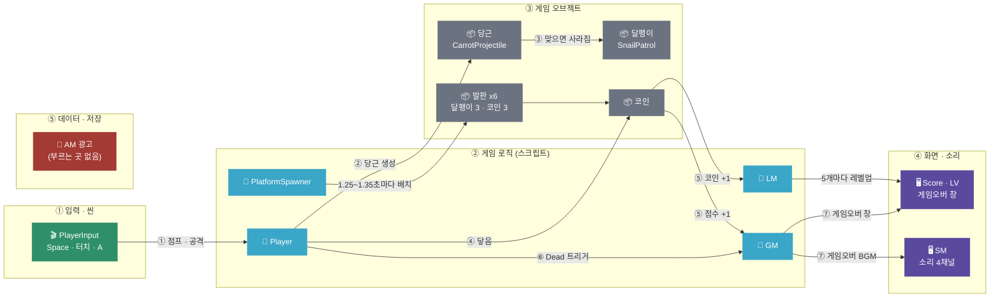
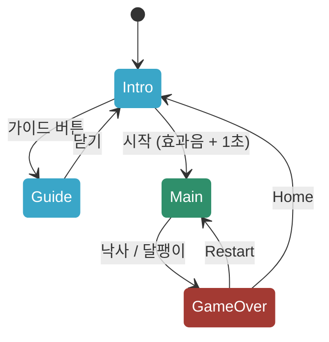
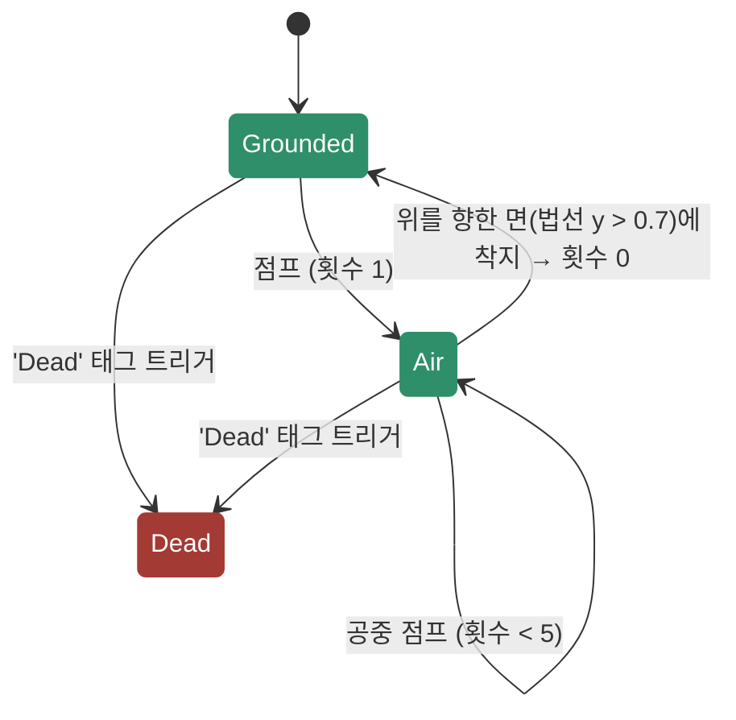
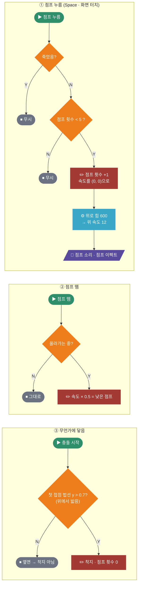
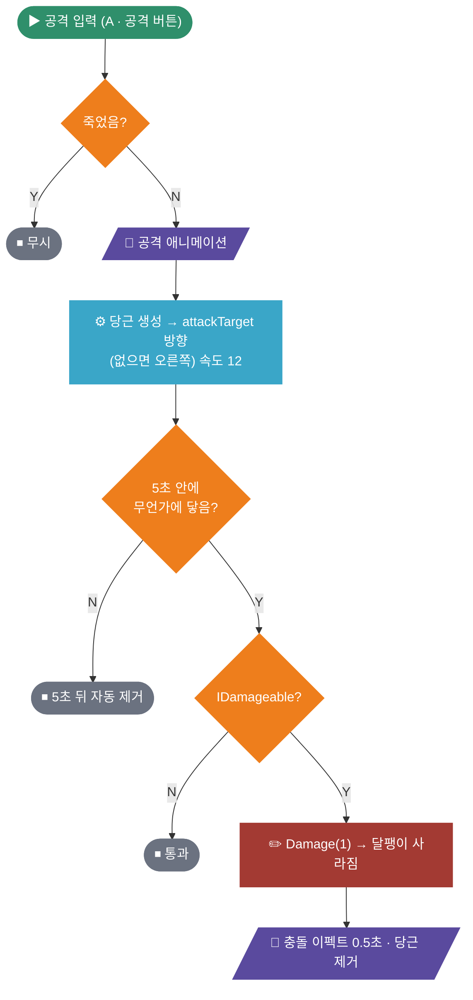
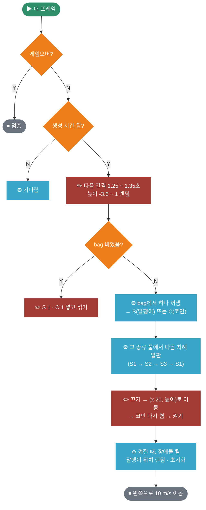
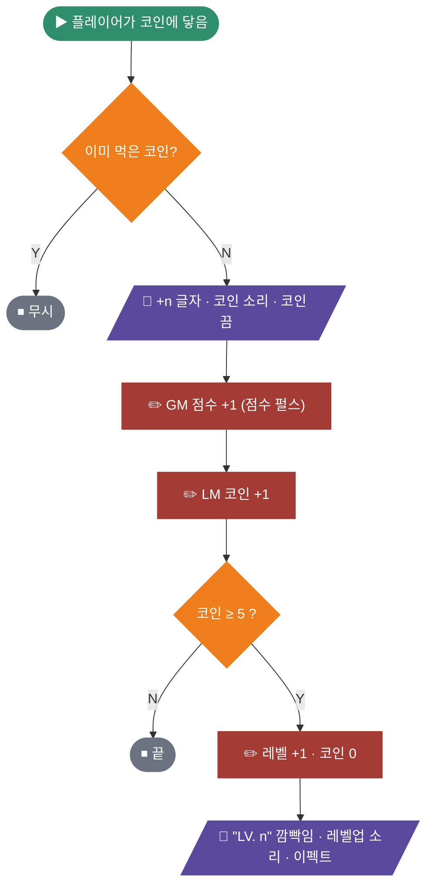
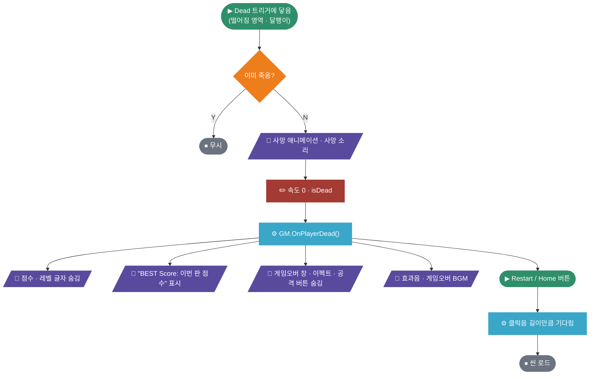
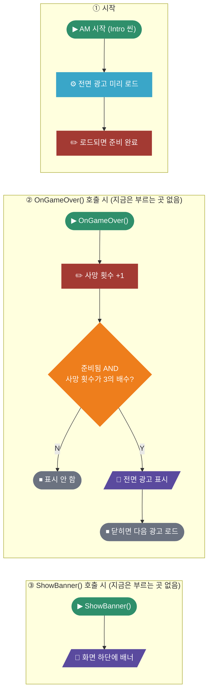
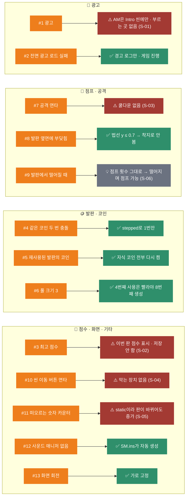

# 시스템 — 러너 · 발판 · 성장 · 광고

> 문서 세트: [목차](../Index.md) · 기획: [컨셉](Concept.md) · **시스템** · [전투·개체](Combat_Entity.md) · [레벨 디자인](LevelDesign.md) · [밸런스](Balance.md) · 사업·운영: [사업 검토](../대표/Business.md) · [요구사항·로드맵](Requirements.md) · [Business Model](Monetization.md) · [서버·데이터](../개발/Server_Data.md) · [리소스](../디자인/Resources.md) · [로그·지표](Analytics.md) · [QA·출시](../QA/QA_Release.md) · [라이브 운영](../운영/LiveOps.md) · [사업화·법무](../대표/Business_Legal.md) · [needFix](../needFix.md)
> 관련 코드: `Player.cs` · `PlayerInput.cs` · `PlatformSpawner.cs` · `Platform.cs` · `Coin.cs` · `GM.cs` · `LM.cs` · `SM.cs` · `SCM.cs` · `AM.cs`

> **문서 정보** · 문서 번호 `D03-SYSTEM` · 버전 v1.0 · 상태 `Review` · 담당 기획자 · 클라이언트 개발자 · 최종 수정 2026-11-21 · 관련 문서 [전투·개체](Combat_Entity.md) · [Business Model](Monetization.md)

**변경 이력**

| 버전 | 날짜 | 변경 내용 | 사유 | 결정자 | 영향 범위 |
|---|---|---|---|---|---|
| v0.9 | 2026-11-20 | 기존 문서 (자세한 기록은 git 커밋) | — | 기획자 | — |
| v1.0 | 2026-11-21 | 문서 정보 · 변경 이력 · 문서 번호 추가, 사업 · 운영 문서와 연결 | — | 기획자 | 문서만 |

---

## 0. 한눈에 보는 시스템 구조

**[구성도] 스크립트 연결**


## 1. 화면 흐름
빌드 씬: `0 Intro` → `1 Main` (`2 protocal`은 테스트 씬)

**[상태도] 화면 전환**


**[와이어프레임] 플레이 화면 (기준 640 × 360)**
```
+----------------------------------------------------------------+
|                                                                |
|                                                    ------------|
|                                                    :          :|
|                                                    :     A    :|
|                                                    ------------|
|                 -------------------------------                |
|                 :                             :                |
|                 :              D              :                |
|                 -------------------------------                |
|                                                                |
|                                                                |
|                                                                |
|                                             --------           |
|                   ------------------------------B---           |
|                   :                        :                   |
|                   :            C           :                   |
|                   :                        :                   |
|                   --------------------------                   |
+----------------------------------------------------------------+
```

| 표시 | 요소 | 하는 일 | 씬 이름 · 화면 위치 (x, y 픽셀, 왼쪽 아래 = 0) |
|---|---|---|---|
| A | 레벨 글자 | "LV. n" · 레벨업 때 깜빡임 | `Level` · 524.4 ~ 637.6, 264 ~ 314 |
| B | 공격 버튼 | 당근 던지기 | `AttackButton` · 455.4 ~ 525.4, 90 ~ 110 |
| C | 점수 | 코인 점수 | `Score Text` · 194.9 ~ 443.1, 24 ~ 100.1 |
| D | 게임오버 글자 (게임오버 때만 켜짐) | 게임오버 창 | `Gameover Text (1)` · 172.5 ~ 472.5, 193.2 ~ 242.2 |

점프는 버튼이 없고 **화면 아무 곳이나 터치**해요 (누르는 시간 = 높이).

## 2. 상태 머신

**게임 (`GM`)**
| 상태 | 발판 생성 | 달팽이 | 점수 | BGM |
|---|---|---|---|---|
| Playing | 1.25 ~ 1.35초마다 | 왕복 | 코인마다 +1 | Main 음악 |
| GameOver | 멈춤 | 정지 (애니메이션 끔) | 더 안 쌓임 | 게임오버 음악 |

**[상태도] 러너 (`Player`)**


## 3. 작동 로직
### 3-1. 입력 (`PlayerInput`)

> 세부 조건(코드 기준)은 [부록 A-1](#a-1-입력-playerinput)에 있어요.

### 3-2. 점프

**[흐름도] 점프**


> 세부 조건(코드 기준)은 [부록 A-2](#a-2-점프)에 있어요.

### 3-3. 공격

**[흐름도] 당근 공격**


```
  B  >>>>>>>>>>>>>>>>>>>>>>>>  @     당근 속도 12, 맞으면 데미지 1 = 달팽이 사라짐
     |<------ 5s x 12 = 60 ------>|  아무것도 안 맞으면 5초 뒤 제거
```

> 세부 조건(코드 기준)은 [부록 A-3](#a-3-공격)에 있어요.

### 3-4. 발판 생성 (오브젝트 풀 + bag)

**[흐름도] 발판 하나가 나오기까지**


**bag 방식 (섞인 주머니)**
```
1) fill    : [S] [C]
2) shuffle : [C] [S]
3) take one by one -> empty -> back to 1)

result : S C | C S | S C | C S | C S | S C
               ^^^^^
               같은 종류는 최대 2번 연속

S = 달팽이 발판 · C = 코인 발판
```

> 세부 조건(코드 기준)은 [부록 A-4](#a-4-발판-생성-오브젝트-풀--bag)에 있어요.

### 3-5. 코인 · 점수 · 레벨

**[흐름도] 코인을 먹었을 때**


> 세부 조건(코드 기준)은 [부록 A-5](#a-5-코인--점수--레벨)에 있어요.

### 3-6. 게임오버

**[흐름도] 죽은 순간부터 다시 시작까지**


> 세부 조건(코드 기준)은 [부록 A-6](#a-6-게임오버)에 있어요.

### 3-7. 광고 (`AM`)

**[흐름도] 광고 (코드에 있는 흐름 · 지금은 호출 없음)**


> 세부 조건(코드 기준)은 [부록 A-7](#a-7-광고-am)에 있어요.

## 4. 예외 처리 (Edge Case) — 현재 동작
**[구성도] 예외 처리 지도**


| # | 상황 | 현재 동작 | 상태 |
|---|---|---|---|
| 1 | 광고 | `AM`은 Intro 씬에만 있고, 광고 함수를 부르는 곳이 없음 | ⚠️ → [S-01](../needFix.md) |
| 2 | 전면 광고 로드 실패 | 경고 로그만, 게임은 진행 | ✅ |
| 3 | 최고 점수 | "BEST Score"에 이번 판 점수를 표시, 저장 안 함 | ⚠️ → [S-02](../needFix.md) |
| 4 | 같은 코인 두 번 충돌 | `stepped`로 1번만 | ✅ |
| 5 | 재사용된 발판의 코인 | 생성 때 자식 코인 전부 다시 켬 | ✅ |
| 6 | 풀 크기 3 | 같은 종류 4번째 사용은 빨라야 8번째 생성 (밸런스 §4) | ✅ |
| 7 | 공격 연타 | 쿨다운 없음 | ⚠️ → [S-03](../needFix.md) |
| 8 | 옆면에 부딪힘 | 법선 y ≤ 0.7이면 착지로 안 봄 | ✅ |
| 9 | 발판에서 떨어질 때 | 점프 횟수 그대로 → 떨어지면서도 점프 가능 | → [S-06](../needFix.md) |
| 10 | 씬 이동 버튼 연타 | 막는 장치 없음 | ⚠️ → [S-04](../needFix.md) |
| 11 | 떠오르는 숫자 카운터 | `static`이라 판이 바뀌어도 계속 증가 | ⚠️ → [S-05](../needFix.md) |
| 12 | 사운드 매니저 없음 | `SM.ins`가 자동으로 만들어 줌 | ✅ |
| 13 | 화면 회전 | 가로 고정 (`LandscapeMode`) | ✅ |

---

## 부록 A. 세부 조건 (코드 기준)
본문 흐름도의 조건을 코드 그대로 적은 개발 참고용이에요. 기획 내용은 본문에 있어요.

### A-1. 입력 (`PlayerInput`)
```
PC     : 점프 = Space 누른 순간 / 뗀 순간, 공격 = A 누른 순간 (새 Input System)
모바일  : 점프 = 화면 터치 누른 순간 / 뗀 순간, 공격 = AttackButton
```

### A-2. 점프
```
점프 누름
├─ IF 사망 → 무시
├─ IF 점프 횟수 < 5
│   ├─ 횟수 +1
│   ├─ 속도를 (0, 0)으로 → 위로 힘 600 (씬 값, 질량 1 · 물리 간격 0.02초 → 위 속도 12)
│   └─ 점프 소리(플레이어 전용 스피커, 이전 소리를 끊음) · 점프 이펙트(2초)
└─ ELSE → 무시
점프 뗌
└─ IF 올라가는 중 → 속도 × 0.5
착지 (충돌 시작)
└─ IF 첫 접점 법선 y > 0.7 (위에서 밟음) → 바닥, 횟수 0
```

### A-3. 공격
```
공격 입력
├─ IF 사망 → 무시
├─ 공격 애니메이션
└─ 당근 생성 → 조준 대상(attackTarget)이 있으면 그쪽, 없으면 오른쪽으로 속도 12 → 5초 뒤 제거
당근 충돌 → IF IDamageable → Damage(1) → 이펙트(0.5초) → 당근 제거
```

### A-4. 발판 생성 (오브젝트 풀 + bag)
```
시작: 달팽이 발판 3개 · 코인 발판 3개를 화면 밖 대기소(0, -25)에 미리 생성
매 프레임
├─ IF 게임오버 → 멈춤
└─ IF 다음 생성 시간 도달
    ├─ 다음 간격 = 1.25 ~ 1.35초 랜덤, 높이 = -3.5 ~ 1 랜덤 (씬 값)
    ├─ 종류 = bag에서 하나 꺼내기
    │   └─ IF bag 비었음 → [달팽이 × 1, 코인 × 1] 채우고 섞기 (Fisher-Yates)
    ├─ 해당 종류 풀에서 다음 차례 발판 (3개 돌려 쓰기)
    ├─ 끈 상태에서 (x = 20, 높이)로 옮김 → 자식 코인 전부 다시 켬 → 다시 켬
    │   └─ 켜질 때 장애물 활성 (obstacleChance 100%), 달팽이 위치 랜덤 · 상태 초기화
    └─ 발판은 ScrollingObject로 왼쪽 10 m/s 이동
```

### A-5. 코인 · 점수 · 레벨
```
코인에 Player 태그가 닿음
├─ IF 이미 먹음 → 무시
└─ ELSE → 떠오르는 숫자 · GM 점수 +1(점수 글자 펄스) · LM 코인 +1 · 코인 소리 · 코인 끔
LM 코인 ≥ 5 → 레벨 +1, 코인 0, "LV. n" 빨간 깜빡임, 레벨업 소리(전용 스피커), 레벨업 이펙트
```

### A-6. 게임오버
```
'Dead' 태그 트리거(떨어짐 영역 · 달팽이)에 닿음 AND 살아 있음
├─ 사망 애니메이션 · 사망 소리 · 속도 0 · isDead
└─ GM.OnPlayerDead()
    ├─ 점수 · 레벨 글자 숨김, "BEST Score: (이번 판 점수)" 표시
    ├─ isGameover, 게임오버 창 · 이펙트 켬, 공격 버튼 숨김
    └─ 효과음 + BGM을 게임오버 음악으로
```

### A-7. 광고 (`AM`)
```
시작 → 전면 광고 미리 로드 (로드되면 준비 완료)
OnGameOver() 호출 시: 사망 횟수 +1
├─ IF 준비 안 됨 OR 사망 횟수가 3의 배수가 아님 → 표시 안 함
└─ ELSE → 전면 광고 표시 → 닫히면 다음 광고 다시 로드
ShowBanner(): 하단에 배너 / HideBanner()
```
